# PF2e Campaign Trackers

GM Core's subsystems and a few table-neutral trackers in one window: Reputation, Pressure, Victory Points, Skill Challenges, Influence, Research, Chases, Infiltration, Clocks and Checklists. Everything is hidden from players until the GM reveals it. Checks roll through the PF2e system and the GM applies the result from the roll card. In a skill challenge, players can propose their own approach and the GM approves it with a DC on the spot. Dates on clocks and checklists send the GM a whisper when the calendar reaches them. Other modules can ship campaign content as a preset.

## What it looks like

One window, a tab for each kind of tracker. Everything starts hidden: reveal a tracker, a threshold or a check when the players should see it. Checks roll from the window through the PF2e system.

<table>
<tr>
<td width="50%" valign="top">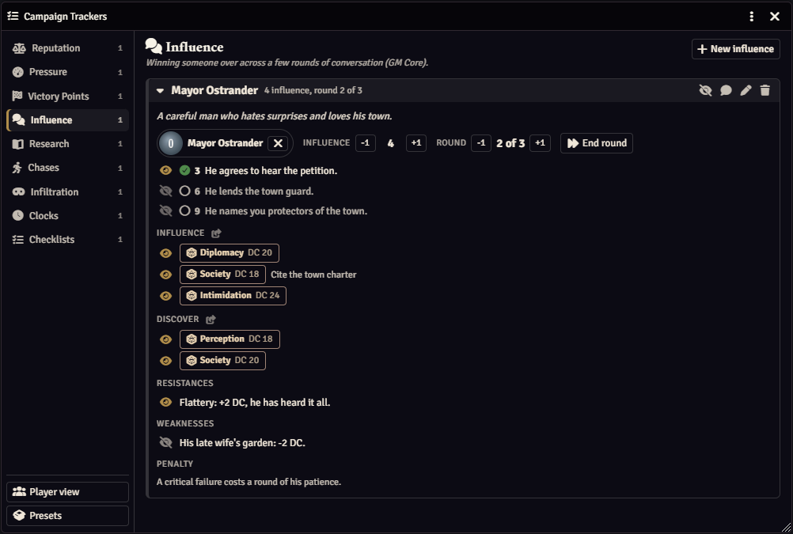</td>
<td width="50%" valign="top">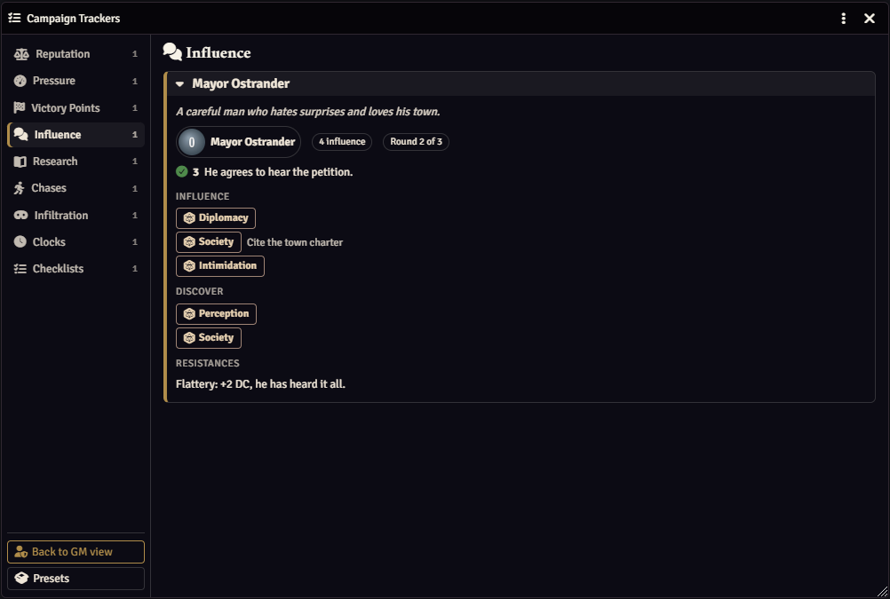</td>
</tr>
<tr>
<td valign="top"><b>Influence</b>, as the GM sees it: DCs, every threshold, and a weakness the party hasn't found yet.</td>
<td valign="top">The same tracker in the players' window: only what's been revealed, and no DCs.</td>
</tr>
</table>
<table>
<tr>
<td width="50%" valign="top">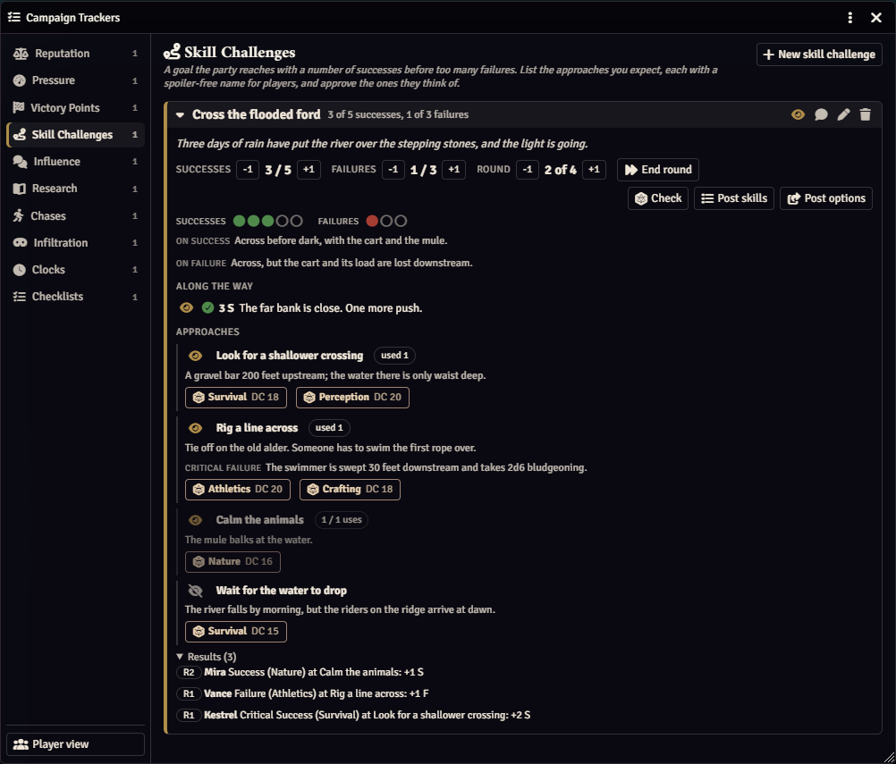</td>
<td width="50%" valign="top">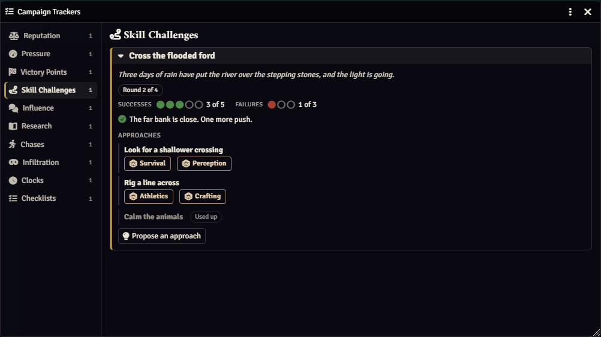</td>
</tr>
<tr>
<td valign="top"><b>Skill challenges</b>, as the GM sees it: what each approach really is, its DCs, a consequence on a critical failure, a hidden approach, and the results so far.</td>
<td valign="top">The same challenge in the players' window: spoiler-free approach names, no DCs, and a button to propose their own.</td>
</tr>
</table>
<table>
<tr>
<td width="50%" valign="top">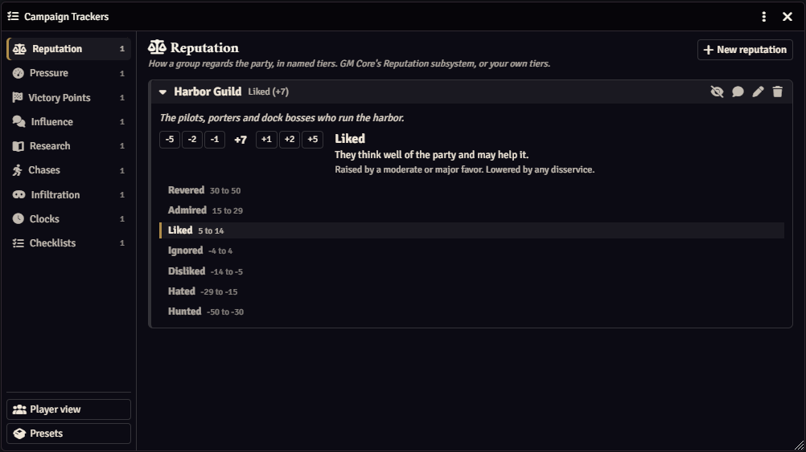</td>
<td width="50%" valign="top">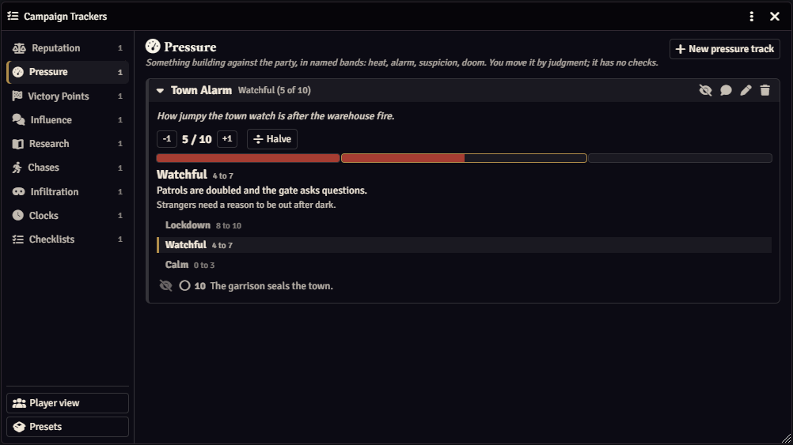</td>
</tr>
<tr>
<td valign="top"><b>Reputation.</b> How a faction regards the party, on GM Core's tiers or your own. Each tier says what it means and what moves it.</td>
<td valign="top"><b>Pressure.</b> Something building against the party (heat, alarm, suspicion) in named bands that you move by judgment.</td>
</tr>
</table>
<table>
<tr>
<td width="50%" valign="top">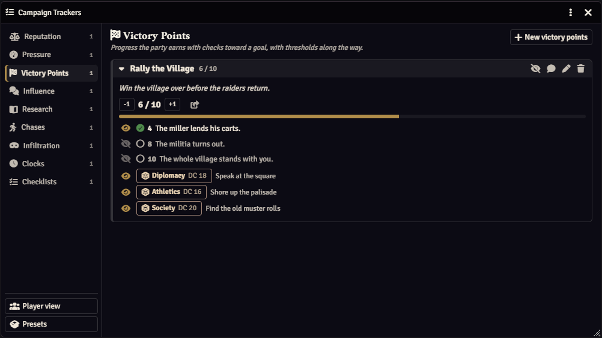</td>
<td width="50%" valign="top">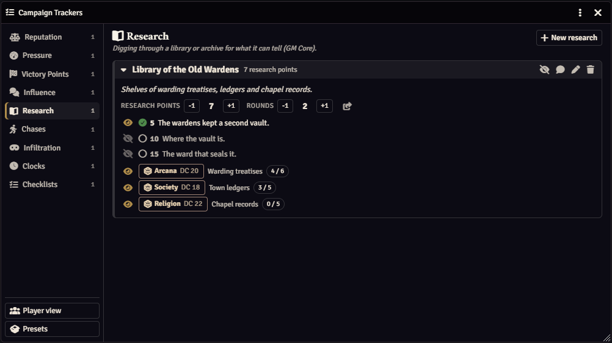</td>
</tr>
<tr>
<td valign="top"><b>Victory Points.</b> Progress toward a goal, with thresholds that unlock as the party reaches them and the checks that earn points.</td>
<td valign="top"><b>Research.</b> A library or archive, with research points per source and what each threshold turns up.</td>
</tr>
</table>
<table>
<tr>
<td width="50%" valign="top">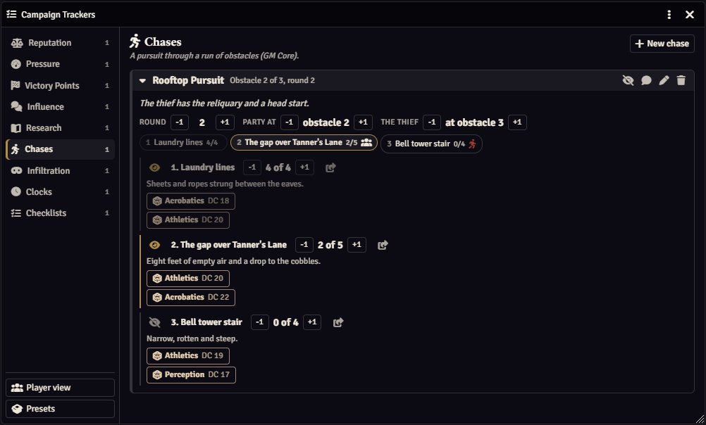</td>
<td width="50%" valign="top">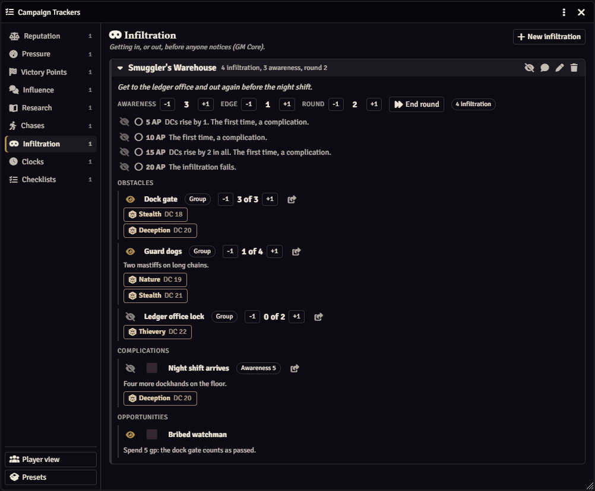</td>
</tr>
<tr>
<td valign="top"><b>Chases.</b> A run of obstacles, the party's progress through each one, and how far ahead the quarry is.</td>
<td valign="top"><b>Infiltration.</b> Awareness, edge, obstacles, complications and opportunities, with GM Core's awareness thresholds built in.</td>
</tr>
</table>
<table>
<tr>
<td width="50%" valign="top">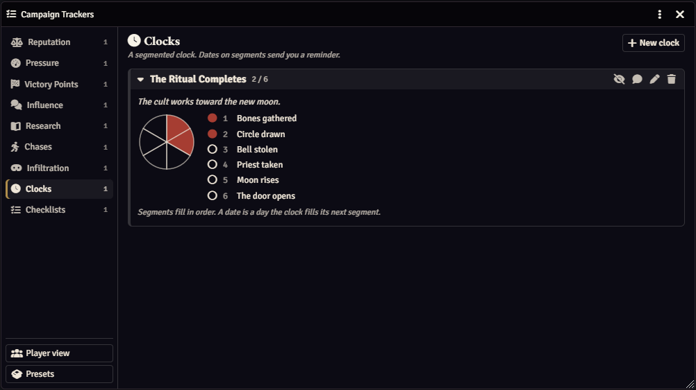</td>
<td width="50%" valign="top">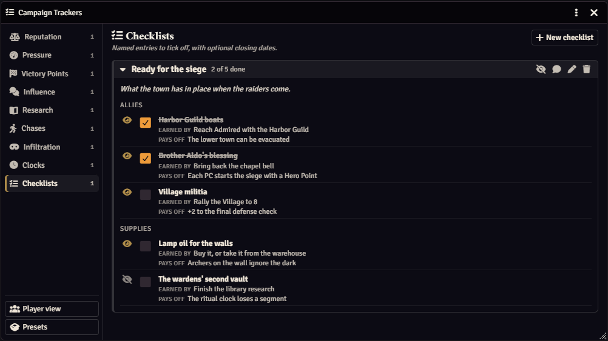</td>
</tr>
<tr>
<td valign="top"><b>Clocks.</b> A segmented clock. Give segments in-game dates and you get a whisper when the calendar reaches them.</td>
<td valign="top"><b>Checklists.</b> Things to gather or prepare, what earns each one and what it pays off, with optional closing dates.</td>
</tr>
</table>

## Install

In Foundry, go to **Add-on Modules**, then **Install Module**, and paste this into **Manifest URL**:

```
https://github.com/Sir-Bayard/pf2e-campaign-trackers/releases/latest/download/module.json
```

Foundry's **Update** button then picks up each new release. You can also download `module.zip` from the [latest release](https://github.com/Sir-Bayard/pf2e-campaign-trackers/releases/latest) and unzip it into `Data/modules/pf2e-campaign-trackers`.

Requires Foundry VTT 14 (verified on 14.369) and the Pathfinder 2e system 8.0.0 or later.

Updating keeps your trackers. Export them first anyway (see [Backup: export and import](#backup-export-and-import)).

## What it does

GM Core's subsystems and a few table-neutral trackers in one window, one tab each: Reputation, Pressure, Victory Points, Skill Challenges, Influence, Research, Chases, Infiltration, Clocks and Checklists. Everything is hidden from players until you reveal it. Checks roll through the PF2e system and you apply the result from the roll card. Dates on clocks and checklist entries whisper you a reminder when the calendar reaches them. Another module can ship campaign content as a preset.

It replaces PF2e Subsystems. Rebuild any event you had there as a tracker here, then turn PF2e Subsystems and PF2e Subsystem Theming off.

## Opening it

Token controls on the left: the list icon at the bottom of the list. Keyboard: Alt+T (change it under Configure Controls).

Macro: `game.modules.get("pf2e-campaign-trackers").api.open()`

The window remembers its tab, which cards are folded and which GM-notes boxes are open, in this browser.

## The tabs

- **Reputation**: A number with named tiers. Starts with GM Core's tiers (Hunted to Revered, -50 to +50); change them to your own. Each tier has text players see and text only you see.
- **Pressure**: Something building against the party: heat, alarm, suspicion, doom. A number in named bands, each with text for players and for you, plus events at set values. You move it with + and -; it has no checks. Hidden number by default, and a Halve button.
- **Victory Points**: Progress the party earns with checks toward a goal, with thresholds along the way.
- **Skill Challenges**: A number of successes before too many failures, reached through approaches you list and approaches the players propose. See [Skill challenges](#skill-challenges).
- **Influence**: An NPC, influence points, thresholds, influence skills, Discover checks, resistances, weaknesses and rounds.
- **Research**: Research points, thresholds, and research checks, each with the most points it can give.
- **Chases**: A run of obstacles with chase points, the party's position and the other side's (the quarry, or pursuers).
- **Infiltration**: Awareness with GM Core's thresholds, edge points, group and individual obstacles, complications and opportunities.
- **Clocks**: Segmented clocks. Click a segment to fill or empty it; right-click marks it broken by the party. A segment can have a date.
- **Checklists**: Named entries in groups, with a tag, a closing date, what earns them and what they pay off.

Click New on a tab to add one. The pencil edits it, the eye shows or hides it, the speech bubble posts it to chat, the bin deletes it.

## Hidden until revealed

Every tracker starts hidden. The eye on a tracker shows it to players; inside it, the eyes on tiers, thresholds, checks, obstacles and entries show those too. Players never see your notes or the "GM only" text, and roll cards show DCs only as PF2e's own "show DCs" setting allows. "Player view" at the bottom of the tab list shows you the window as players see it.

Your data is kept in a journal entry called "Campaign Trackers (GM data)", hidden from players. Leave it where it is: the module refuses to delete it, and warns if a copy of it turns up. Players' windows are drawn from a copy of what you have revealed, nothing more.

Hidden means hidden from the players' screens, not secret. Foundry sends every journal entry and world setting to every player's browser, whatever its permissions, so a player who goes looking in the browser console can read all of it: your notes, hidden trackers, DCs. Keep anything truly secret out of Foundry.

## Backup: export and import

The window's title-bar menu has "Export data", which downloads everything as a JSON file, and "Import data", which replaces everything with such a file after asking. Export before a session, and before you upgrade.

If the stored data ever can't be read, nothing can be changed until it's fixed: export it (you get the text as it is), fix the file, import it. To delete the data journal on purpose (say, to remove a duplicate), export first, then run

```
game.modules.get("pf2e-campaign-trackers").api.unlockStore("<journal id>")
```

and delete it. Without an id it unlocks the journal in use.

If you have the window open in two tabs, the one that saves second reloads the other's data instead of overwriting it, and tells you.

## Posting to chat

The speech bubble posts what players would see of a tracker: a standing's tier, a clock's face, where the chase stands. Use it when you tell the table something changed. On a hidden tracker it asks first.

## Checks and the apply button

Each check has a skill, a DC and what it's for. Skill is the PF2e slug: athletics, perception, will, or a lore such as sailing-lore.

- Click a check to roll it for the selected tokens (or a player's own character).
- The share icon posts the checks to chat as buttons players click to roll. On Influence, Research and Victory Points only revealed checks are posted.
- The roll card gets an Apply button that only you see. It says what it will do ("Success, +1 at The open lead") and does nothing until you click it. After that the card says what was applied.

Points per result follow GM Core (critical success 2, success 1, critical failure -1) and can be changed per tracker. Infiltration uses GM Core's rules: successes earn infiltration points, failures add awareness. A roll made from the character sheet isn't tied to a tracker and has no Apply button; use the + and - buttons instead.

Once applied, the card says what it did and has an Undo, which takes back exactly that roll's result and nothing done since. When a player rerolls an applied check with a hero point, PF2e replaces the roll card; the new card says what the first roll applied and offers to replace it with the new result. That offer needs a GM logged in at the time of the reroll; otherwise Undo the first result yourself before applying the new one.

## Skill challenges

A skill challenge is a goal the party reaches with a number of successes before too many failures: crossing a flooded river, talking a mob down, finding the way through a marsh. It's built for the players to say what their characters do and why a skill fits, not just to pick from a list.

**Setting one up.** Under Edit:

- Successes needed, failures allowed and, if you like, a number of rounds. Each result adds successes and failures; by default a critical success adds 2 successes, a success 1, a failure and a critical failure 1 failure each. Change any of them.
- What happens on success and on failure (GM only), and milestones along the way at a number of successes.
- **Approaches**: the ways through you expect. Each has a name players see, which you keep free of spoilers ("Look for another way across"), the real story for you ("A gravel bar 200 feet upstream makes a shallower crossing"), an optional consequence on a critical failure, an optional limit on uses, and one or more skills, each with a DC. Reveal an approach with its eye when the players should know about it.
- **Players see the counts**: off, and players see the approaches but not how close they are.
- **Proposals need what and why**: on by default. Turn it off when pace matters, and players can propose with just a skill.
- **One check per PC per round**: Apply tells you when a character rolls a second time in a round. It warns; it doesn't stop the roll.

**Running it.** The challenge card has four buttons:

- **Post skills** posts the skills that could help, from every approach, hidden ones included, with no approaches and no DCs. Players say what they do.
- **Post options** posts the revealed approaches by their players' names, each with its skills as roll buttons.
- **Check** calls for a check on the fly. Pick the characters, the skill and the DC, and what it counts as: one of your approaches (it counts a use) or on its own. Then send them a roll button each, or roll for them at once.
- Rounds and End round show when the challenge has a round limit or one check per round.

**Proposals.** Both chat cards, and the challenge in the players' window, have **Propose an approach**. A player picks one of their character's skills and writes what they do and why the skill fits. The proposal goes to chat for the table to see. On it you can change the skill, set the DC (Easy and Hard move it by 2), choose what it counts as, save it as a new approach for the challenge (players see it by what they wrote), and approve or decline it with a reason. Approved, it becomes a roll button for that player.

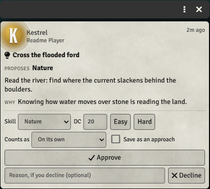

The DC on a proposal or a check starts from an approach that uses the same skill, or else from the standard DC for the character's level.

**What players see.** Never a DC: not in their window, not on the cards, not on their roll, which says only "Success" or "Failure". Every roll records through your Apply button as usual, and the challenge keeps a list of the results. A critical failure on an approach with a consequence shows it to you on the Apply box. As with everything here, DCs aren't secret from a player who digs through the browser console (see [Hidden until revealed](#hidden-until-revealed)).

The DC filled in on a proposal or a check comes from a revealed approach that uses the same skill and isn't used up. Hidden approaches are never picked for you: choose one under "Counts as" when that's what the player has stumbled on.


## Reminders

When the in-game date reaches or passes a date on a clock segment or a checklist entry, you get one whispered reminder listing everything due, even after a time skip. Nothing changes by itself: you fill the segment or tick the entry. On a clock set to "Fills in order", each date fills the next empty segment. Turn reminders off in the module settings.

You also get a whisper when a threshold is crossed, a tier or band changes, or the party clears an obstacle or catches the quarry.

## Presets

A module can register trackers with

```
game.modules.get("pf2e-campaign-trackers").api.registerPreset({
  id, label, version, trackers: [...]
})
```

They are added hidden the first time. When the version changes, their text is updated and values, progress, ticks and reveals are kept (for a skill challenge, its counts, the uses of each approach and the list of results). Tiers, thresholds, checks, segments and entries you added yourself stay (so do ones the preset dropped; remove those by hand). "Presets" at the bottom of the tab list reloads a preset's text by hand.

## For macros

```
const api = game.modules.get("pf2e-campaign-trackers").api;
api.adjust("tracker-id", "value", 1);
api.set("tracker-id", "segments.2.state", "filled");
api.reveal("tracker-id");
api.list()   // every tracker, with its id
```

## Changes

See [CHANGELOG.md](CHANGELOG.md).

## How it was made

This module was written with Claude, Anthropic's AI assistant, directed and tested by its author at a real table. It is shared as is, for free.

## Problems and suggestions

Open an [issue](https://github.com/Sir-Bayard/pf2e-campaign-trackers/issues).

## License

[MIT](LICENSE). Copyright (c) 2026 Sir Bayard.

## Pathfinder

PF2e Campaign Trackers is an unofficial, free module for the Pathfinder Second Edition system on Foundry VTT. It is not published, endorsed or specifically approved by Paizo Inc. Pathfinder is a trademark of Paizo Inc., used here only to say which game the module works with. The module follows the game's rules, which Paizo publishes under the ORC License, and refers to them by name; it doesn't reproduce Paizo's rules text, art or setting material.
