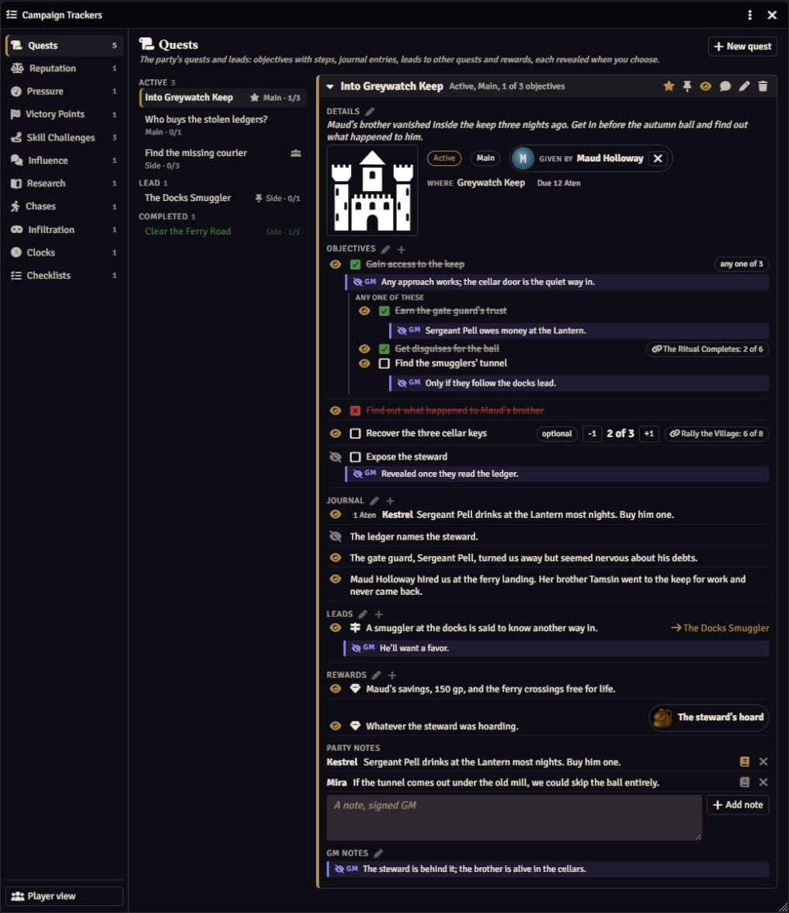
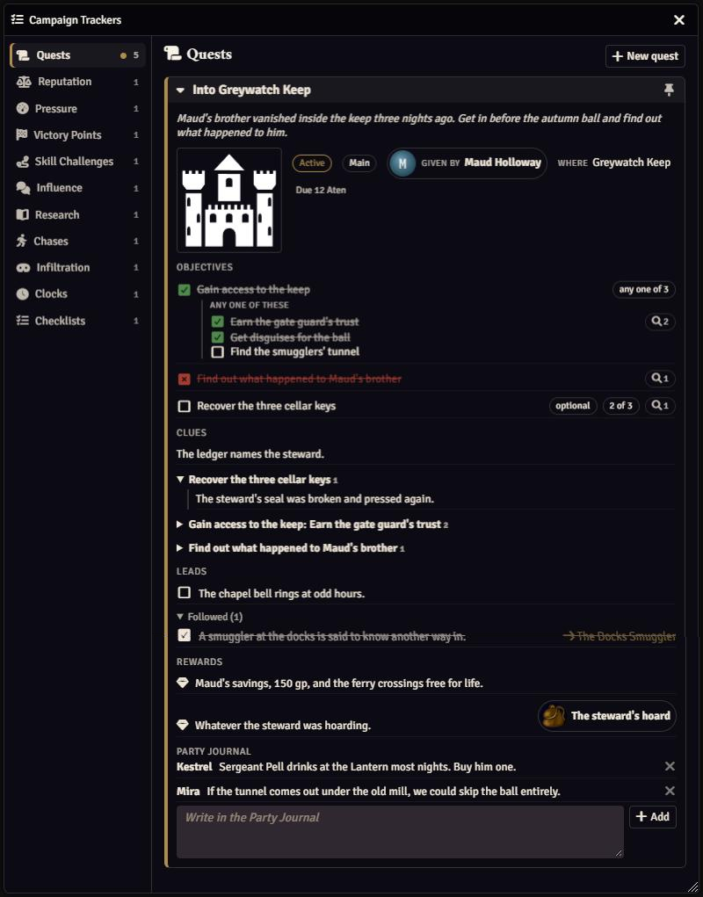
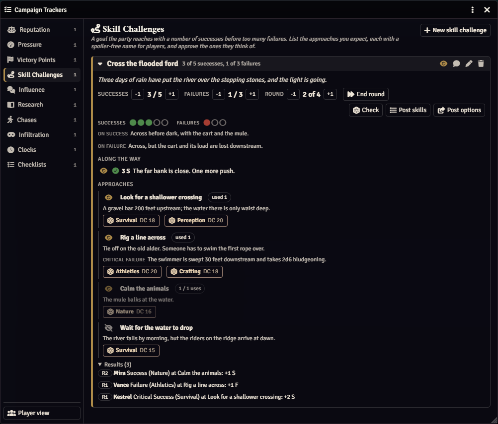
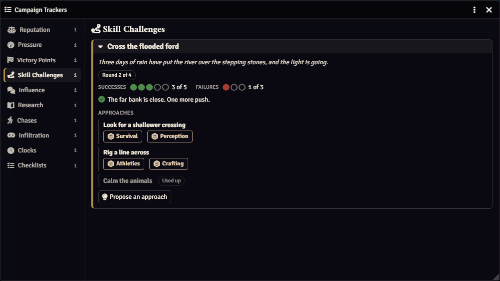

# PF2e Campaign Trackers

A quest log, GM Core's subsystems and a few table-neutral trackers in one window: Quests, Reputation, Pressure, Victory Points, Skill Challenges, Influence, Research, Chases, Infiltration, Clocks and Checklists.

Everything is hidden from players until the GM reveals it. Quests have objectives with steps, clues filed under the objectives they belong to, leads that reveal clues and other quests, and reveals prepared for when something is done; players tick objectives, follow leads, write in a Party Journal and start party quests of their own, and a panel keeps the party's quests on screen. Checks roll through the PF2e system and the GM applies each result from the roll card, or has a check's results applied as they're rolled. In a skill challenge, or in ordinary play from a hotbar macro, players propose a check and the GM approves it with a DC on the spot. Dates on clocks, checklists and quests send the GM a whisper when the calendar reaches them. Other modules can ship campaign content as a preset.

## What it looks like

<table>
<tr>
<td width="50%" valign="top"></td>
<td width="50%" valign="top"></td>
</tr>
<tr>
<td valign="top"><b>Quests</b>, as the GM sees it: objectives with steps, a link to another tracker, clues filed under the objectives they belong to, a lead that reveals two clues, a Hidden fold, and notes only the GM sees.</td>
<td valign="top">The same quest in the players' window: what's been revealed, boxes to tick, clues by objective, a followed lead, and the Party Journal.</td>
</tr>
</table>
<table>
<tr>
<td width="50%" valign="top"></td>
<td width="50%" valign="top"></td>
</tr>
<tr>
<td valign="top"><b>Skill challenges</b>, as the GM sees it: what each approach really is, its DCs, a consequence on a critical failure, a hidden approach, and the results so far.</td>
<td valign="top">The same challenge in the players' window: spoiler-free approach names, no DCs, and a button to propose their own.</td>
</tr>
</table>

The [guide](docs/guide.md#the-tabs) has a picture of every tab.

## Install

In Foundry, go to **Add-on Modules**, then **Install Module**, and paste this into **Manifest URL**:

```
https://github.com/Sir-Bayard/pf2e-campaign-trackers/releases/latest/download/module.json
```

Foundry's **Update** button then picks up each new release. You can also download `module.zip` from the [latest release](https://github.com/Sir-Bayard/pf2e-campaign-trackers/releases/latest) and unzip it into `Data/modules/pf2e-campaign-trackers`.

Requires Foundry VTT 14 (verified on 14.370) and the Pathfinder 2e system 8.0.0 or later (verified on 8.7.0).

Updating keeps your trackers. Export them first anyway (see [Backup](docs/guide.md#backup-export-and-import)).

## What it does

- **Quests**: objectives with steps, clues, leads, rewards, due dates and a Party Journal. See [Quests](docs/quests.md).
- **Skill Challenges**: successes before too many failures, through approaches you list and approaches players propose. See [Skill challenges](docs/skill-challenges.md).
- **Reputation**, **Victory Points**, **Influence**, **Research**, **Chases** and **Infiltration**: GM Core's subsystems, with checks that roll from the window.
- **Pressure**, **Clocks** and **Checklists**: things you move by judgment, with dates that remind you.

It replaces PF2e Subsystems: rebuild any event you had there as a tracker here, then turn PF2e Subsystems and PF2e Subsystem Theming off.

## Getting started

Open the window from the token controls (the list icon at the bottom), with Alt+T, or with `game.modules.get("pf2e-campaign-trackers").api.open()`. Click **New** on a tab to make a tracker. The pencil edits it, the eye shows it to players, the speech bubble posts it to chat, and its menu (the three dots) holds Duplicate, Export this tracker and Delete. **Undo** at the foot of the tab list (or Ctrl+Z) takes back the last change you made in the window.

Inside a tracker, the eyes on tiers, thresholds, checks, obstacles and entries reveal those too, and **Player view** shows you the window as players see it. Hidden means hidden from the players' screens, not secret: Foundry sends every journal entry and setting to every browser, so keep anything truly secret out of Foundry.

Click a check to roll it for the selected tokens, or post the checks to chat for players to roll. Each roll card gets an Apply button only you see; it says what it will do, and the card keeps an Undo once applied.

The whole window and the quest panel work from the keyboard: Tab moves between controls, Enter and Space press them, the arrow keys move along the tab list, Escape closes a menu, and Shift+Enter does what a right-click does.

## Rules from the PF2e system

The DC for each level, the DC adjustments (Easy, Hard), GM Core's reputation tiers, and the points each degree of success earns in Victory Points, Influence, Research, Chases and Infiltration are read from the PF2e system's GM Screen journal when a GM logs in. The module keeps no copy of these tables. If a system update moves one, you're told once, and the feature asks you for the number instead.

## Read more

- [The guide](docs/guide.md): every tab, hiding and revealing, backups, checks and Apply, reminders, presets, the API, and what needs a GM logged in.
- [Quests](docs/quests.md): objectives, clues, leads, party quests, the quest panel, quest links and reveal links.
- [Skill challenges](docs/skill-challenges.md): approaches, proposals and running one at the table.

## Changes

See [CHANGELOG.md](CHANGELOG.md).

## How it was made

This module was written with Claude, Anthropic's AI assistant, directed and tested by its author at a real table. It is shared as is, for free.

## Problems and suggestions

Open an [issue](https://github.com/Sir-Bayard/pf2e-campaign-trackers/issues).

## License

[MIT](LICENSE). Copyright (c) 2026 Sir Bayard.

## Pathfinder

PF2e Campaign Trackers is an unofficial, free module for the Pathfinder Second Edition system on Foundry VTT. It is not published, endorsed or specifically approved by Paizo Inc. Pathfinder is a trademark of Paizo Inc., used here only to say which game the module works with. The module follows the game's rules, which Paizo publishes under the ORC License, and refers to them by name; it doesn't reproduce Paizo's rules text, art or setting material.
