# PF2e Campaign Trackers

A quest log, GM Core's subsystems and a few table-neutral trackers in one window: Quests, Reputation, Pressure, Victory Points, Skill Challenges, Influence, Research, Chases, Infiltration, Clocks and Checklists. Everything is hidden from players until the GM reveals it. Quests have objectives with steps, leads between quests and reveals prepared for when something is done; players can tick objectives, add notes and start party quests of their own, and a panel keeps the party's quests on screen. Checks roll through the PF2e system and the GM applies the result from the roll card. In a skill challenge, players can propose their own approach and the GM approves it with a DC on the spot. Dates on clocks, checklists and quests send the GM a whisper when the calendar reaches them. Other modules can ship campaign content as a preset.

## What it looks like

One window, a tab for each kind of tracker. Everything starts hidden: reveal a tracker, a threshold or a check when the players should see it. Checks roll from the window through the PF2e system.

<table>
<tr>
<td width="50%" valign="top">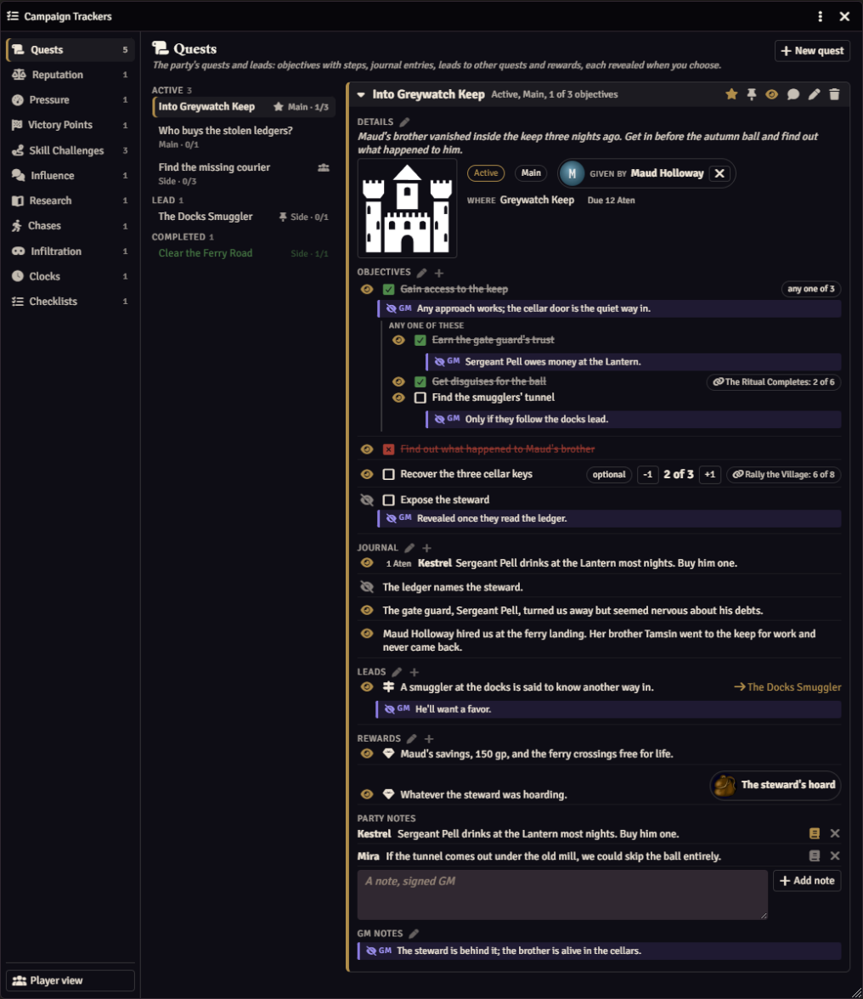</td>
<td width="50%" valign="top">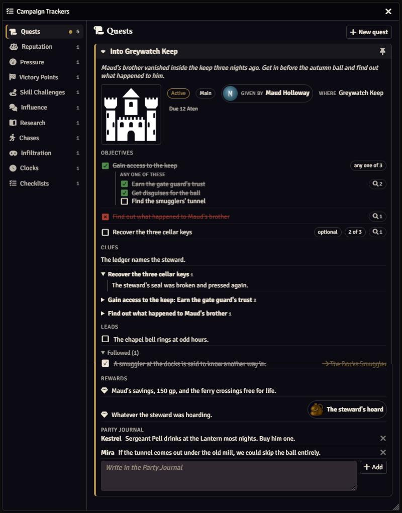</td>
</tr>
<tr>
<td valign="top"><b>Quests</b>, as the GM sees it: the list by status, objectives with steps, a link to another tracker, hidden parts and notes only the GM sees.</td>
<td valign="top">The same quest in the players' window: what's been revealed, boxes to tick, and the party's notes.</td>
</tr>
</table>
<table>
<tr>
<td width="50%" valign="top">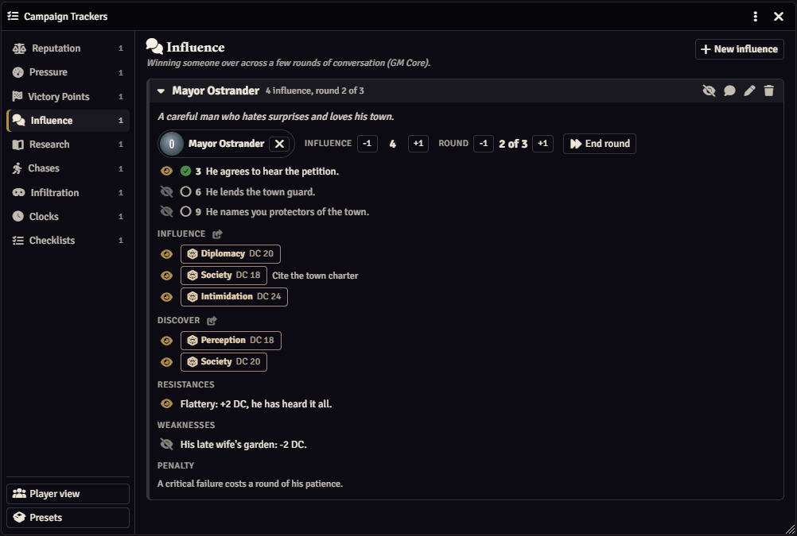</td>
<td width="50%" valign="top">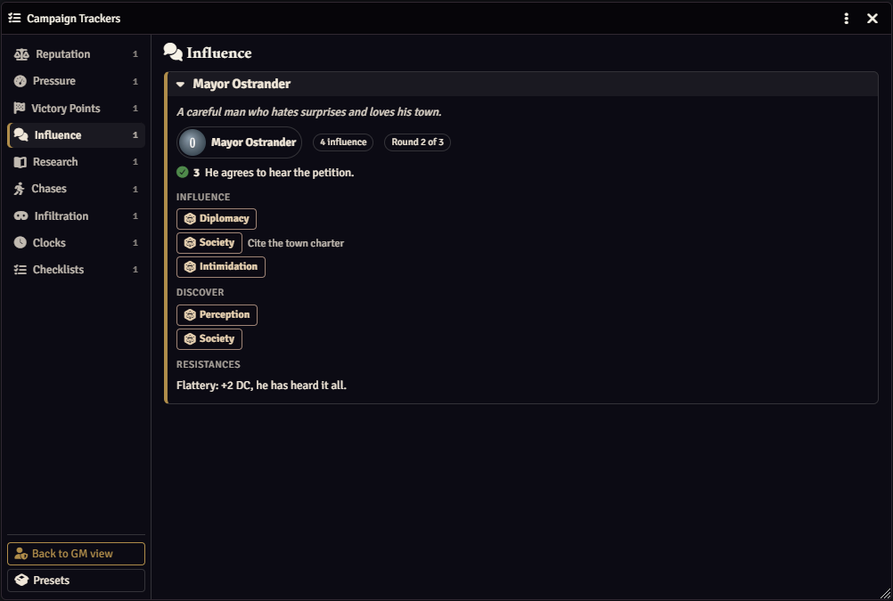</td>
</tr>
<tr>
<td valign="top"><b>Influence</b>, as the GM sees it: DCs, every threshold, and a weakness the party hasn't found yet.</td>
<td valign="top">The same tracker in the players' window: only what's been revealed, and no DCs.</td>
</tr>
</table>
<table>
<tr>
<td width="50%" valign="top">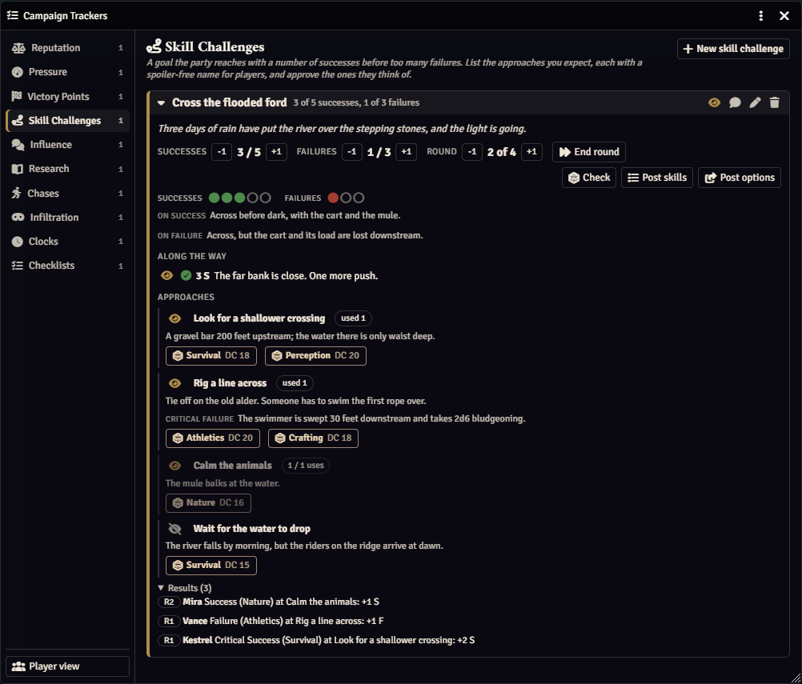</td>
<td width="50%" valign="top">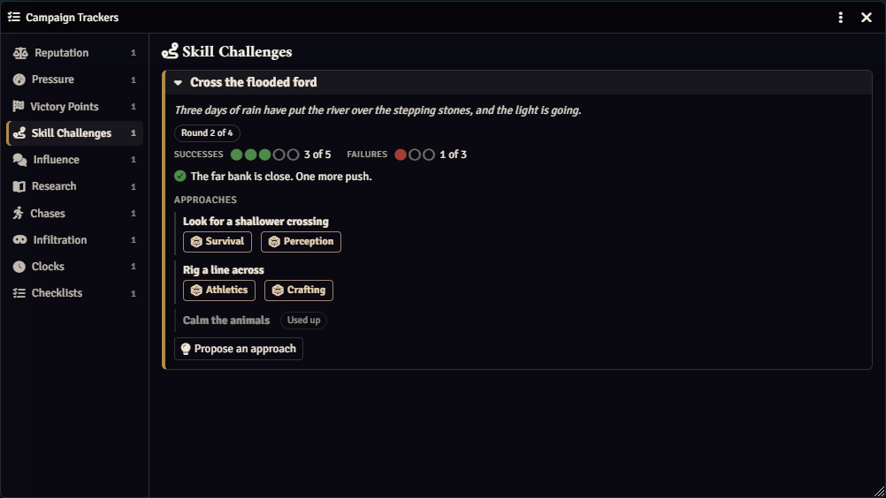</td>
</tr>
<tr>
<td valign="top"><b>Skill challenges</b>, as the GM sees it: what each approach really is, its DCs, a consequence on a critical failure, a hidden approach, and the results so far.</td>
<td valign="top">The same challenge in the players' window: spoiler-free approach names, no DCs, and a button to propose their own.</td>
</tr>
</table>
<table>
<tr>
<td width="50%" valign="top">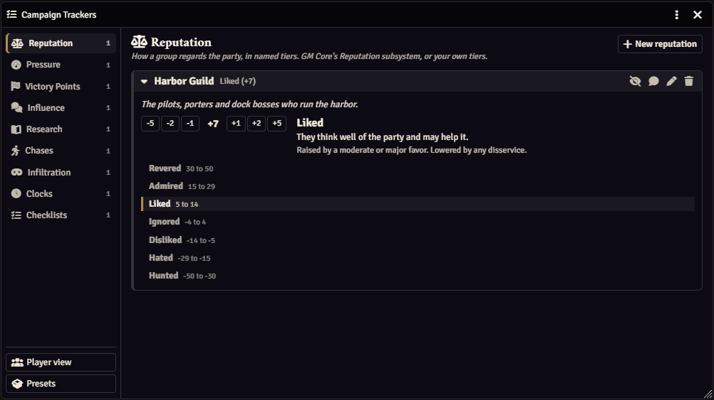</td>
<td width="50%" valign="top">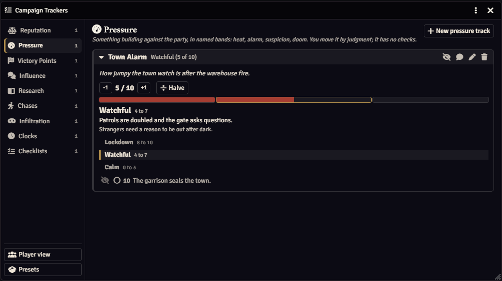</td>
</tr>
<tr>
<td valign="top"><b>Reputation.</b> How a faction regards the party, on GM Core's tiers or your own. Each tier says what it means and what moves it.</td>
<td valign="top"><b>Pressure.</b> Something building against the party (heat, alarm, suspicion) in named bands that you move by judgment.</td>
</tr>
</table>
<table>
<tr>
<td width="50%" valign="top">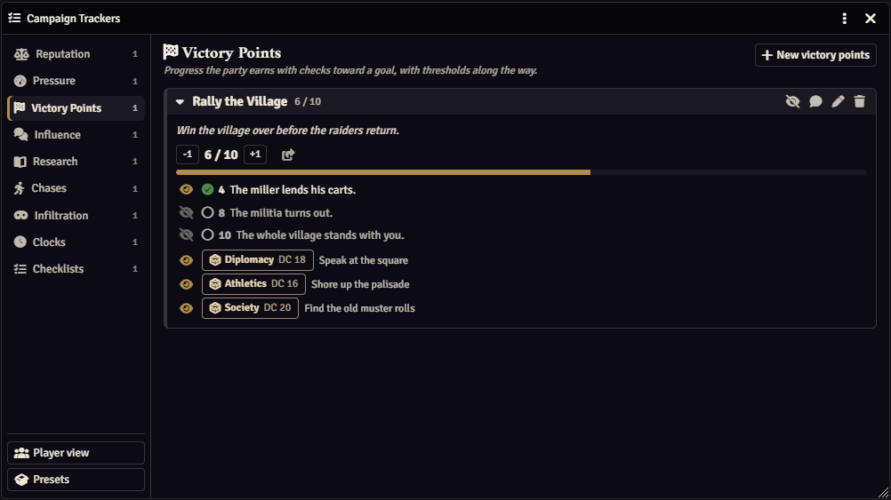</td>
<td width="50%" valign="top">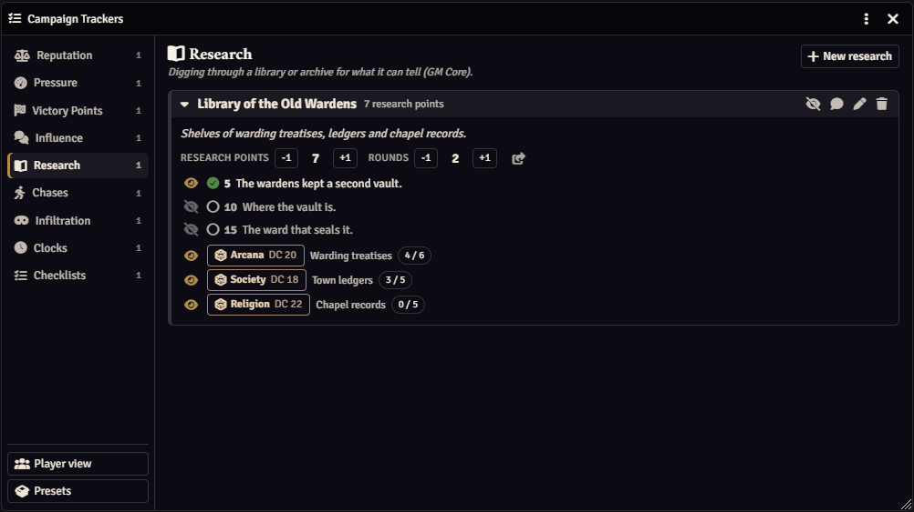</td>
</tr>
<tr>
<td valign="top"><b>Victory Points.</b> Progress toward a goal, with thresholds that unlock as the party reaches them and the checks that earn points.</td>
<td valign="top"><b>Research.</b> A library or archive, with research points per source and what each threshold turns up.</td>
</tr>
</table>
<table>
<tr>
<td width="50%" valign="top">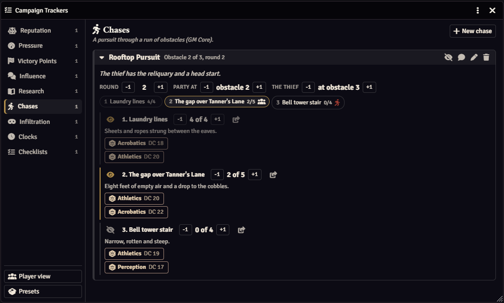</td>
<td width="50%" valign="top">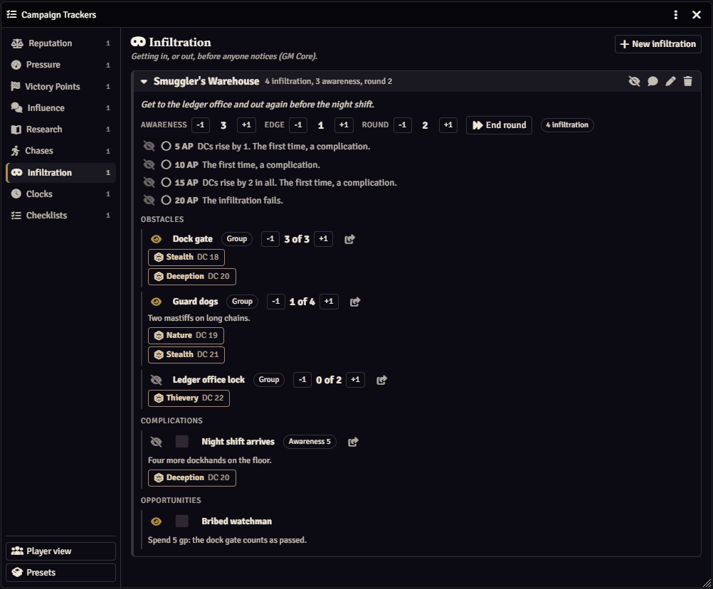</td>
</tr>
<tr>
<td valign="top"><b>Chases.</b> A run of obstacles, the party's progress through each one, and how far ahead the quarry is.</td>
<td valign="top"><b>Infiltration.</b> Awareness, edge, obstacles, complications and opportunities, with GM Core's awareness thresholds built in.</td>
</tr>
</table>
<table>
<tr>
<td width="50%" valign="top">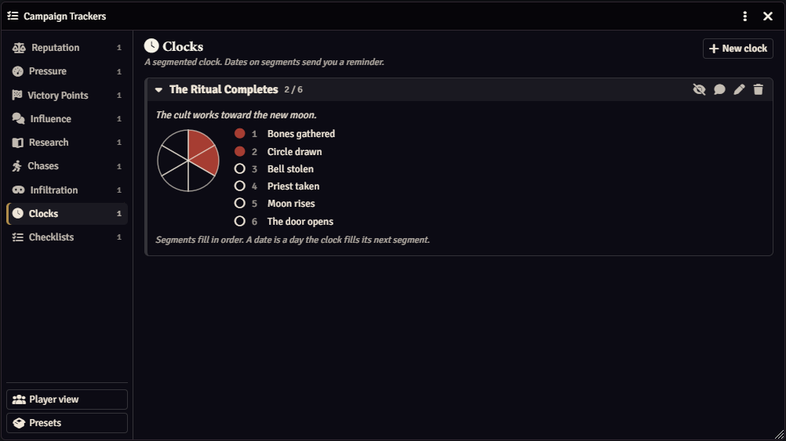</td>
<td width="50%" valign="top">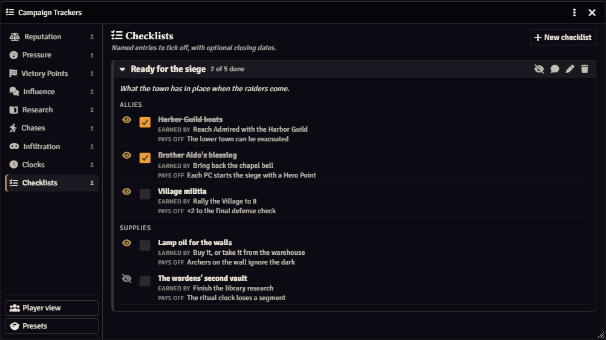</td>
</tr>
<tr>
<td valign="top"><b>Clocks.</b> A segmented clock. Give segments in-game dates and you get a whisper when the calendar reaches them.</td>
<td valign="top"><b>Checklists.</b> Things to gather or prepare, what earns each one and what it pays off, with optional closing dates.</td>
</tr>
</table>

## Install

In Foundry, go to **Add-on Modules**, then **Install Module**, and paste this into **Manifest URL**:

```
https://github.com/Sir-Bayard/pf2e-campaign-trackers/releases/latest/download/module.json
```

Foundry's **Update** button then picks up each new release. You can also download `module.zip` from the [latest release](https://github.com/Sir-Bayard/pf2e-campaign-trackers/releases/latest) and unzip it into `Data/modules/pf2e-campaign-trackers`.

Requires Foundry VTT 14 (verified on 14.369) and the Pathfinder 2e system 8.0.0 or later.

Updating keeps your trackers. Export them first anyway (see [Backup: export and import](#backup-export-and-import)).

## What it does

A quest log, GM Core's subsystems and a few table-neutral trackers in one window, one tab each: Quests, Reputation, Pressure, Victory Points, Skill Challenges, Influence, Research, Chases, Infiltration, Clocks and Checklists. Everything is hidden from players until you reveal it. Checks roll through the PF2e system and you apply the result from the roll card. Dates on clocks, checklist entries and quests whisper you a reminder when the calendar reaches them. Another module can ship campaign content as a preset.

It replaces PF2e Subsystems. Rebuild any event you had there as a tracker here, then turn PF2e Subsystems and PF2e Subsystem Theming off.

## Opening it

Token controls on the left: the list icon at the bottom of the list. Keyboard: Alt+T (change it under Configure Controls).

Macro: `game.modules.get("pf2e-campaign-trackers").api.open()`, or `api.open("reputation")` to open it on a tab (see [For macros](#for-macros)).

The window remembers its size and place, its tab, which cards are folded and which GM-notes boxes are open, in this browser.

## The tabs

- **Quests**: A quest log: objectives with steps, a journal, leads to other quests, rewards, due dates, and notes from the players. See [Quests](#quests).
- **Reputation**: A number with named tiers. Starts with GM Core's tiers (Hunted to Revered, -50 to +50); change them to your own. Each tier has text players see and text only you see.
- **Pressure**: Something building against the party: heat, alarm, suspicion, doom. A number in named bands, each with text for players and for you, plus events at set values. You move it with + and -; it has no checks. Hidden number by default, and a Halve button.
- **Victory Points**: Progress the party earns with checks toward a goal, with thresholds along the way.
- **Skill Challenges**: A number of successes before too many failures, reached through approaches you list and approaches the players propose. See [Skill challenges](#skill-challenges).
- **Influence**: An NPC, influence points, thresholds, influence skills, Discover checks, resistances, weaknesses and rounds.
- **Research**: Research points, thresholds, and research checks, each with the most points it can give.
- **Chases**: A run of obstacles with chase points, the party's position and the other side's (the quarry, or pursuers).
- **Infiltration**: Awareness with GM Core's thresholds, edge points, group and individual obstacles, complications and opportunities.
- **Clocks**: Segmented clocks. Click a segment to fill or empty it; right-click marks it broken by the party. A segment can have a date.
- **Checklists**: Named entries in groups, with a tag, a closing date, what earns them and what they pay off.

Click New on a tab to add one. The pencil edits it, the eye shows or hides it, the speech bubble posts it to chat, the bin deletes it.

## Hidden until revealed

Every tracker starts hidden. The eye on a tracker shows it to players; inside it, the eyes on tiers, thresholds, checks, obstacles and entries show those too. Players never see your notes or the "GM only" text, and roll cards show DCs only as PF2e's own "show DCs" setting allows. "Player view" at the bottom of the tab list shows you the window as players see it.

Your data is kept in a journal entry called "Campaign Trackers (GM data)", hidden from players. Leave it where it is: the module refuses to delete it, and warns if a copy of it turns up. Players' windows are drawn from a copy of what you have revealed, nothing more.

Hidden means hidden from the players' screens, not secret. Foundry sends every journal entry and world setting to every player's browser, whatever its permissions, so a player who goes looking in the browser console can read all of it: your notes, hidden trackers, DCs. Keep anything truly secret out of Foundry.

## Backup: export and import

The window's title-bar menu has "Export data", which downloads everything as a JSON file, and "Import data", which replaces everything with such a file after asking. Export before a session, and before you upgrade.

If the stored data ever can't be read, nothing can be changed until it's fixed: export it (you get the text as it is), fix the file, import it. To delete the data journal on purpose (say, to remove a duplicate), export first, then run

```
game.modules.get("pf2e-campaign-trackers").api.unlockStore("<journal id>")
```

and delete it. Without an id it unlocks the journal in use.

If you have the window open in two tabs, the one that saves second reloads the other's data instead of overwriting it, and tells you.

## Posting to chat

The speech bubble posts what players would see of a tracker: a standing's tier, a clock's face, where the chase stands. Use it when you tell the table something changed. On a hidden tracker it asks first.

## Checks and the apply button

Each check has a skill, a DC and what it's for. Skill is the PF2e slug: athletics, perception, will, or a lore such as sailing-lore.

- Click a check to roll it for the selected tokens (or a player's own character).
- The share icon posts the checks to chat as buttons players click to roll. On Influence, Research and Victory Points only revealed checks are posted.
- The roll card gets an Apply button that only you see. It says what it will do ("Success, +1 at The open lead") and does nothing until you click it. After that the card says what was applied.

Points per result follow GM Core (critical success 2, success 1, critical failure -1) and can be changed per tracker. Infiltration uses GM Core's rules: successes earn infiltration points, failures add awareness. A roll made from the character sheet isn't tied to a tracker and has no Apply button; use the + and - buttons instead.

Once applied, the card says what it did and has an Undo, which takes back exactly that roll's result and nothing done since. When a player rerolls an applied check with a hero point, PF2e replaces the roll card; the new card says what the first roll applied and offers to replace it with the new result. That offer needs a GM logged in at the time of the reroll; otherwise Undo the first result yourself before applying the new one.

## Skill challenges

A skill challenge is a goal the party reaches with a number of successes before too many failures: crossing a flooded river, talking a mob down, finding the way through a marsh. It's built for the players to say what their characters do and why a skill fits, not just to pick from a list.

**Setting one up.** Under Edit:

- Successes needed, failures allowed and, if you like, a number of rounds. Each result adds successes and failures; by default a critical success adds 2 successes, a success 1, a failure and a critical failure 1 failure each. Change any of them.
- What happens on success and on failure (GM only), and milestones along the way at a number of successes.
- **Approaches**: the ways through you expect. Each has a name players see, which you keep free of spoilers ("Look for another way across"), the real story for you ("A gravel bar 200 feet upstream makes a shallower crossing"), an optional consequence on a critical failure, an optional limit on uses, and one or more skills, each with a DC. Reveal an approach with its eye when the players should know about it.
- **Players see the counts**: off, and players see the approaches but not how close they are.
- **Proposals need what and why**: on by default. Turn it off when pace matters, and players can propose with just a skill.
- **One check per PC per round**: Apply tells you when a character rolls a second time in a round. It warns; it doesn't stop the roll.

**Running it.** The challenge card has four buttons:

- **Post skills** posts the skills that could help, from every approach, hidden ones included, with no approaches and no DCs. Players say what they do.
- **Post options** posts the revealed approaches by their players' names, each with its skills as roll buttons.
- **Check** calls for a check on the fly. Pick the characters, the skill and the DC, and what it counts as: one of your approaches (it counts a use) or on its own. Then send them a roll button each, or roll for them at once.
- Rounds and End round show when the challenge has a round limit or one check per round.

**Proposals.** Both chat cards, and the challenge in the players' window, have **Propose an approach**. A player picks one of their character's skills and writes what they do and why the skill fits. The proposal goes to chat for the table to see. On it you can change the skill, set the DC (Easy and Hard move it by 2), choose what it counts as, save it as a new approach for the challenge (players see it by what they wrote), and approve or decline it with a reason. Approved, it becomes a roll button for that player.

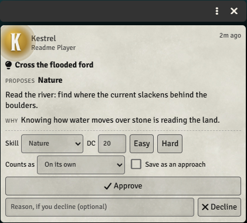

The DC on a proposal or a check starts from an approach that uses the same skill, or else from the standard DC for the character's level.

**What players see.** Never a DC: not in their window, not on the cards, not on their roll, which says only "Success" or "Failure". Every roll records through your Apply button as usual, and the challenge keeps a list of the results. A critical failure on an approach with a consequence shows it to you on the Apply box. As with everything here, DCs aren't secret from a player who digs through the browser console (see [Hidden until revealed](#hidden-until-revealed)).

The DC filled in on a proposal or a check comes from a revealed approach that uses the same skill and isn't used up. Hidden approaches are never picked for you: choose one under "Counts as" when that's what the player has stumbled on.

## Quests

A quest log for the party: what they've taken on, what's next, what they've learned and what it pays. Quests sit in a list on the left, grouped by status, with the chosen quest beside it like a journal. Every part starts hidden, so you can write a quest out ahead of time and reveal it a piece at a time.

**What a quest holds.**

- A status (Lead, Active, Completed or Failed) and a category you name (Main and Side to start). Completed quests show green in the list and failed ones red.
- A picture, who gave it (drop an actor, or type a name), where, and a due date.
- **Objectives**, each with optional **steps** under it. An objective with steps is ready to mark done when all of them are, or when any one is (you choose). Objectives and steps can be optional and can have a count ("3 of 5 keys").
- **Journal** entries, each with a date, for what happened along the way.
- **Leads**: a line of text that can point to another quest.
- **Rewards**: text, and a loot actor if it's treasure.
- Notes only you see, on the quest and on each objective, step, lead and reward. They show in a purple box marked GM, so they never read as something players see.

The pencil on a quest edits all of it. Each section also has its own pencil and +, so you can add an objective or a GM note without opening the rest.

**Running it.** Click an objective's box to mark it done, click again to open it; right-click marks it failed (struck through in red). Each objective, step, journal entry, lead and reward has an eye: reveal it when the players should know.

**What happens when something is done.** In an objective or step's editor, "When it's done, offer to reveal" lists the parts you want revealed once it's done: the next objective, a journal entry, a lead. When it's marked done, you get a whispered card with those parts ticked; untick any, then Reveal. The card also offers to mark the objective done once its steps add up. Nothing is revealed until you click.

**Leads between quests.** A lead can point to another quest. When you reveal a lead whose quest players can't see yet, you're asked whether to reveal that quest too. A quest shows which leads point to it, so you can follow a thread back.

**Linking to other trackers.** With "Watch" in its editor, an objective or step can watch another tracker: a clock filling, a skill challenge won or lost, victory points, research, influence, reputation or pressure reaching a number, a checklist entry ticked, a chase won, an infiltration's objective reached. It shows how that tracker stands ("Rally the Village: 6 of 8"), and when it gets there you get a card offering to mark it done. It never ticks itself.

**Treasure.** Revealing a reward linked to a loot actor offers to let players open that actor (Observer). It's never done for you.

**Deadlines.** A quest's due date shows on the quest, and you get a reminder when the calendar reaches it (see [Reminders](#reminders)). Players see the due date unless you turn off "Players see the due date" for a secret deadline; the reminder comes either way.

**What players can do.**

- Read what you've revealed, and nothing else: no GM notes, no hidden objectives, steps or leads. A lead names the quest it points to only once that quest is revealed.
- Tick a revealed objective or step done. You get a card each time, with anything you prepared to reveal. They can untick what a player ticked, but not what you marked. Turn this off with the setting "Players can tick quest objectives".
- Add notes to a quest, signed with their character's name. Everyone sees them. Players delete their own; you can delete any. The book on a note adds it to the quest's journal, dated today, revealed and signed with the player's name, so a good find becomes part of the record. A gold book means it's already there.
- Start party quests of their own (below).
- Players' ticks, notes and party quests go through a GM's client, so a GM needs to be logged in for them.

**Party quests.** Players can start a quest themselves with **New quest** on the Quests tab, for anything they want to keep track of, so you aren't the only one making and keeping quests. Anyone in the party can edit a party quest: its name, summary, status, category, giver, place and due date, its objectives and steps, journal, leads and rewards. What they add is revealed. Only the player who made it, or you, can delete it. The rest of the party gets a notice when one is made; edits only mark it Updated. Party quests have a party icon in the list.

A party quest is yours to edit too, and you can add hidden parts and GM notes that players can't see or change. Two buttons sit on it: **Make it a main quest** sets its category to Main and leaves it a party quest; **Take it over** makes it an ordinary quest of yours, with everything in it kept. Players still see it, go back to ticking and adding notes, and are told you took it over. Turn party quests off with the setting "Players can make quests".

<table>
<tr>
<td width="50%" valign="top">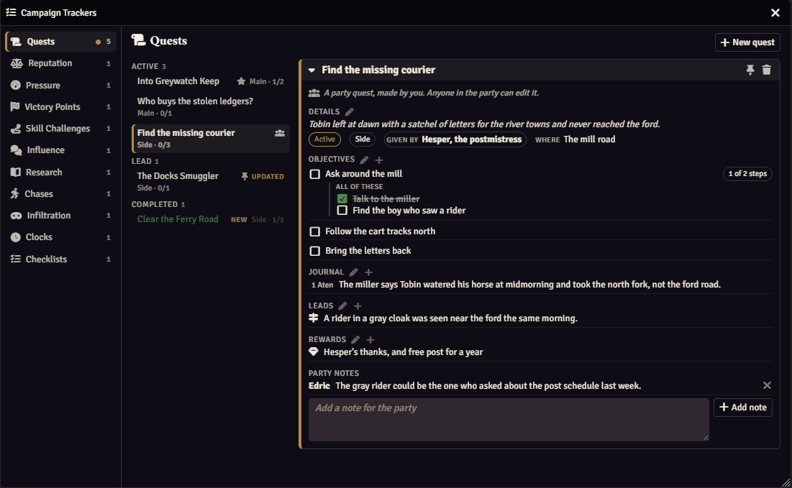</td>
<td width="50%" valign="top">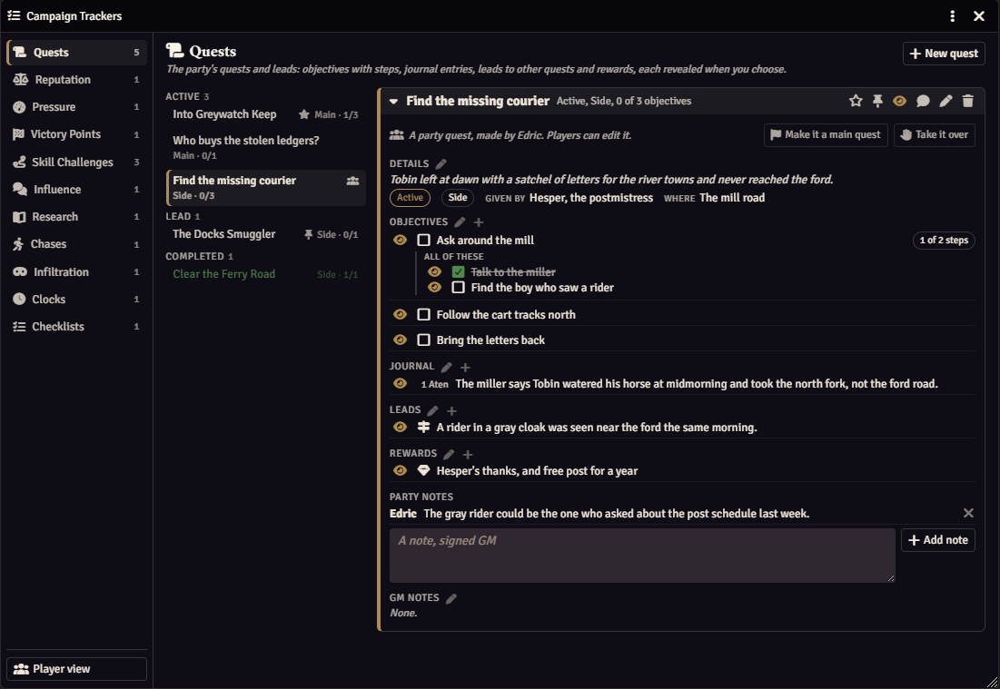</td>
</tr>
<tr>
<td valign="top">A party quest in the window of the player who made it: every section has its pencil and +, and they can delete it.</td>
<td valign="top">The same quest as the GM sees it, with <b>Make it a main quest</b> and <b>Take it over</b>.</td>
</tr>
</table>

**Notices.** When a quest is revealed, changes, is completed or fails, or gets a note, players get a short notice on screen, and the quest is marked New or Updated in their list until they open it. Nothing goes to chat. The setting "Quest notice sound" plays a sound with the notice (off unless you pick one).

**The quest panel.** A small panel on screen with the quests in play and their open objectives, so nobody has to open the window. It shows the party's focus first: the star on a quest makes it the focus for everyone. Then the quests each person pinned with the pin (up to three in all; pins are kept in that person's browser). Players can tick objectives right in the panel, and clicking a quest's name opens it in the window. Your panel also shows hidden objectives, dimmed. Drag the panel by its header; it remembers where. Each person can close it with the × on its header (or the setting "Show the quest panel"); **Show the quest panel** on the Quests tab brings it back. Turning off "Players can open the trackers" hides it from players too.

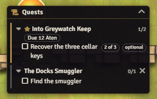

**Quest links.** Write `@Quest[id]` in any journal page (or `@Quest[id]{a label}` for other words), and it shows as a link that opens the quest. Drag a quest from the Quests list into a page's editor to make one; a quest's id is also in `api.quests()`. A player sees a link to a quest they can't open yet as a faded link.

**Reveal links.** A button for your prep notes that reveals parts of a quest when the moment comes, so you don't have to find the right eyes at the table. In your view of a quest, each objective, step, journal entry, lead and reward shows a link icon when you point at it: drag it into a journal page, or click it to copy the link. For one button that reveals several parts, click the link icon in the quest's header, tick the parts, and drag **Drag or copy** into the page (with nothing ticked, the button reveals the quest itself). In the page it reads like `@QuestReveal[quest-id|part-id,part-id]{The porch door}`; the words in braces are the button's label. To add parts to a link later, open the page to read it (not to edit it) and drop the parts' link icons (or a picked set) on its button; the link in the page's text gets them, and keeps its label.

Clicking the button lists what it will reveal, all ticked: the quest if players can't see it yet, each hidden part, the objective a step sits under, the quest a lead points to, and loot players can't open yet. Untick anything to keep it hidden, then **Reveal**. A step always brings the objective it sits under, as it does with the eye, since players see nothing of a step under a hidden objective. Shift-click reveals everything on that list at once, as Shift skips the dialog when you roll. Either way it's one change, so players get one notice. Pointing at the button lists what it covers, with a tick on what players already see; it fades with a check once they see it all, and shows a dashed red border when something it names was deleted. Players see only the label, as plain text, with no hint of what's behind it; a link made by dragging is labeled with the part's text (or the quest's name), so change the label in a page players can read. A reveal link in chat, or in a page a player changed last, always shows the list, even with Shift.

**In Bayard's Campaign Journal.** With [Bayard's Campaign Journal](https://github.com/Sir-Bayard/bayards-campaign-journal) installed, its Quests tab lists the quests and shows each one as the players see it, and quest links clicked there open the quest on that tab.

## Reminders

When the in-game date reaches or passes a date on a clock segment, a checklist entry or a quest, you get one whispered reminder listing everything due, even after a time skip. Nothing changes by itself: you fill the segment or tick the entry. On a clock set to "Fills in order", each date fills the next empty segment. Turn reminders off in the module settings.

You also get a whisper when a threshold is crossed, a tier or band changes, or the party clears an obstacle or catches the quarry.

## Presets

A module can register trackers with

```
game.modules.get("pf2e-campaign-trackers").api.registerPreset({
  id, label, version, trackers: [...]
})
```

They are added hidden the first time. When the version changes, their text is updated and values, progress, ticks and reveals are kept (for a skill challenge, its counts, the uses of each approach and the list of results). Tiers, thresholds, checks, segments and entries you added yourself stay (so do ones the preset dropped; remove those by hand). "Presets" at the bottom of the tab list reloads a preset's text by hand.

For quests, an update keeps the status, ticks, counts, reveals, party notes, the focus and the "Players see the due date" switch. A giver, picture, due date, loot actor, planned reveals or link you set in play stays unless the preset gives its own. A lead's `to` and an objective's `link.tid` can name another tracker in the same preset by its key; it's matched to that tracker's stored id.

## For macros

```
const api = game.modules.get("pf2e-campaign-trackers").api;
api.adjust("tracker-id", "value", 1);
api.set("tracker-id", "segments.2.state", "filled");
api.reveal("tracker-id");
api.list()   // every tracker, with its id
api.open()   // open the window where it was left
api.open("reputation")   // open it on a tab: "quest", "reputation", "pressure", "points", "challenge", "influence",
                         // "research", "chase", "infiltration", "clock", "checklist", a tab's label ("Victory Points"),
                         // or a tracker's id (its tab; for a quest, that quest)
api.openQuest("quest-id")   // open the window on a quest the user can see
api.quests()   // the quests the user can see (the GM: all): id, name, status, statusLabel, category,
               // done and total objectives, revealed, party, focus, and the user's mark ("new", "updated" or "")
api.questHTML("quest-id")   // the quest as players see it, read-only, as HTML (null if players can't see it)
api.markQuestSeen("quest-id")   // clear the user's New/Updated mark on it
api.revealLink("quest-id", ["part-id"], "The porch door")   // a reveal link's text (GM)
api.revealParts("quest-id", ["part-id"], { ask: false })   // reveal as a reveal link does; ask: true shows the list (GM)
// Hooks: "pf2e-campaign-trackers.changed" when trackers or marks change; "pf2e-campaign-trackers.questLink"
// (id, link) when a quest link is clicked: return false to show the quest yourself.
```

## Changes

See [CHANGELOG.md](CHANGELOG.md).

## How it was made

This module was written with Claude, Anthropic's AI assistant, directed and tested by its author at a real table. It is shared as is, for free.

## Problems and suggestions

Open an [issue](https://github.com/Sir-Bayard/pf2e-campaign-trackers/issues).

## License

[MIT](LICENSE). Copyright (c) 2026 Sir Bayard.

## Pathfinder

PF2e Campaign Trackers is an unofficial, free module for the Pathfinder Second Edition system on Foundry VTT. It is not published, endorsed or specifically approved by Paizo Inc. Pathfinder is a trademark of Paizo Inc., used here only to say which game the module works with. The module follows the game's rules, which Paizo publishes under the ORC License, and refers to them by name; it doesn't reproduce Paizo's rules text, art or setting material.
