# PF2e Campaign Trackers: the guide

The window, every tab, and what the GM and players can do. Quests and skill challenges have their own pages: [Quests](quests.md) and [Skill challenges](skill-challenges.md). Back to the [README](../README.md).

## Opening it

Token controls on the left: the list icon at the bottom of the list. Keyboard: Alt+T, which you can change under Configure Controls (in Firefox on Windows, Alt+T also opens the browser's Tools menu, so you may want another key there). Macro: `game.modules.get("pf2e-campaign-trackers").api.open()`, or `api.open("reputation")` to open it on a tab (see [For macros](#for-macros)).

The window remembers its size and place, its tab, which cards are folded and which GM-notes boxes are open, in this browser, for each world and each user.

## The keyboard

Everything in the window and the quest panel works from the keyboard. Tab and Shift+Tab move between controls (and wrap around inside the window), Enter and Space press a button, the arrow keys move along the tab list, Escape closes an open menu, and Shift+Enter on an objective's box or a clock segment does what a right-click does. While you work in the window its keys are its own, so Space doesn't pause the game and the arrows don't move the map; click the map to give them back. Opening the window with Alt+T or the token control puts focus in it. A drag always has a way without one: a clue's grip opens a list of objectives to file it under, a quest's menu has **Copy a link to this quest**, and the panel's Move button moves it with the arrow keys.

## The tabs

- **Quests**: A quest log: objectives with steps, clues, leads to other quests, rewards, due dates, and a Party Journal the players write in. See [Quests](quests.md).
- **Reputation**: A number with named tiers. Starts with GM Core's tiers and range, read from the PF2e system, with what raises and lowers each in the GM's note; change them to your own. Each tier has text players see and text only you see.
- **Pressure**: Something building against the party: heat, alarm, suspicion, doom. A number in named bands, each with text for players and for you, plus events at set values. You move it with + and -; it has no checks. Hidden number by default, and a Halve button. Turn off "Players see the band" to reveal the track but keep its band to yourself; players then see its name and the events you've revealed on it.
- **Victory Points**: Progress the party earns with checks toward a goal, with thresholds along the way.
- **Skill Challenges**: A number of successes before too many failures, reached through approaches you list and approaches the players propose. See [Skill challenges](skill-challenges.md).
- **Influence**: An NPC, influence points, thresholds, influence skills, Discover checks, resistances, weaknesses and rounds. Turn off "Players see the number" to show players the thresholds reached but not the total.
- **Research**: Research points, thresholds, and research checks, each with the most points it can give. "Players see the number" works as on Influence.
- **Chases**: A run of obstacles with chase points, the party's position and the other side's (the quarry, or pursuers).
- **Infiltration**: Awareness with the thresholds you set, edge points, group and individual obstacles, complications and opportunities. It counts the obstacles the party has overcome; an optional infiltration point goal counts points instead.
- **Clocks**: Segmented clocks. Click a segment to fill or empty it; right-click (or Shift+Enter) marks it broken by the party. A segment can have a date.
- **Checklists**: Named entries in groups, with a tag, a closing date, what earns them and what they pay off.

Click New on a tab to add one. The pencil edits it, the eye shows or hides it, the speech bubble posts it to chat. Its menu (the three dots) holds **Duplicate** (a copy just below, hidden from players), **Export this tracker** (a file) and, set apart at the end, **Delete**.

One window, a tab for each kind of tracker. Everything starts hidden: reveal a tracker, a threshold or a check when the players should see it. Checks roll from the window through the PF2e system.

<table>
<tr>
<td width="50%" valign="top">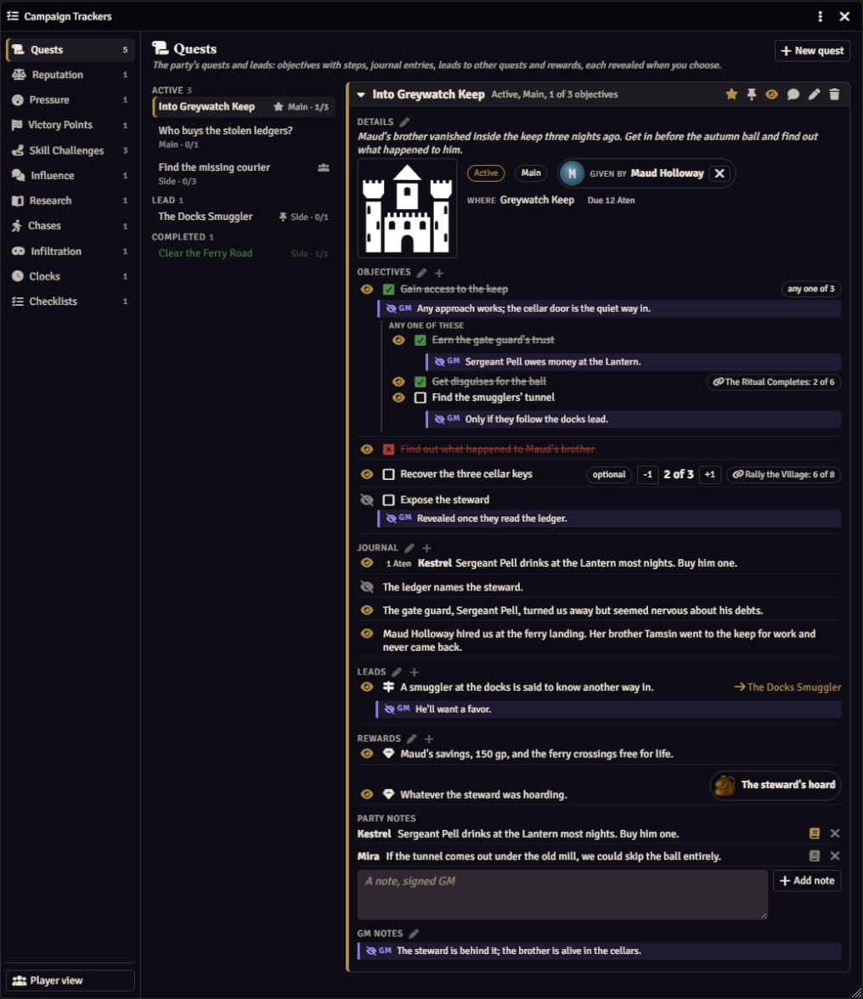</td>
<td width="50%" valign="top">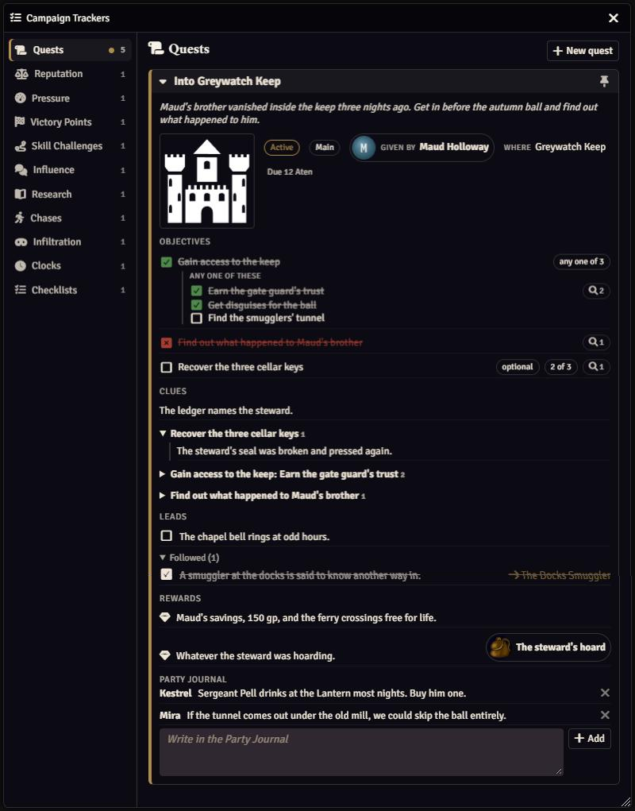</td>
</tr>
<tr>
<td valign="top"><b>Quests</b>, as the GM sees it: objectives with steps, a link to another tracker, clues filed under the objectives they belong to, a lead that reveals two clues, a Hidden fold, and notes only the GM sees.</td>
<td valign="top">The same quest in the players' window: what's been revealed, boxes to tick, clues by objective, a followed lead, and the Party Journal.</td>
</tr>
</table>
<table>
<tr>
<td width="50%" valign="top">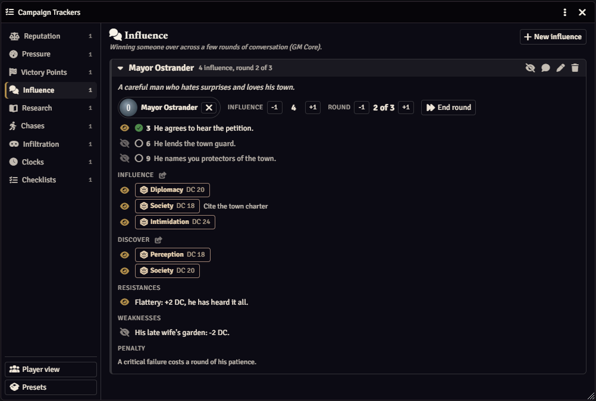</td>
<td width="50%" valign="top">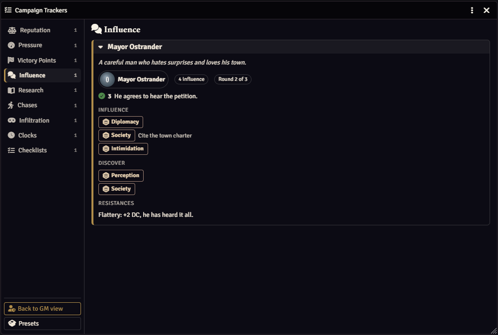</td>
</tr>
<tr>
<td valign="top"><b>Influence</b>, as the GM sees it: DCs, every threshold, and a weakness the party hasn't found yet.</td>
<td valign="top">The same tracker in the players' window: only what's been revealed, and no DCs.</td>
</tr>
</table>
<table>
<tr>
<td width="50%" valign="top">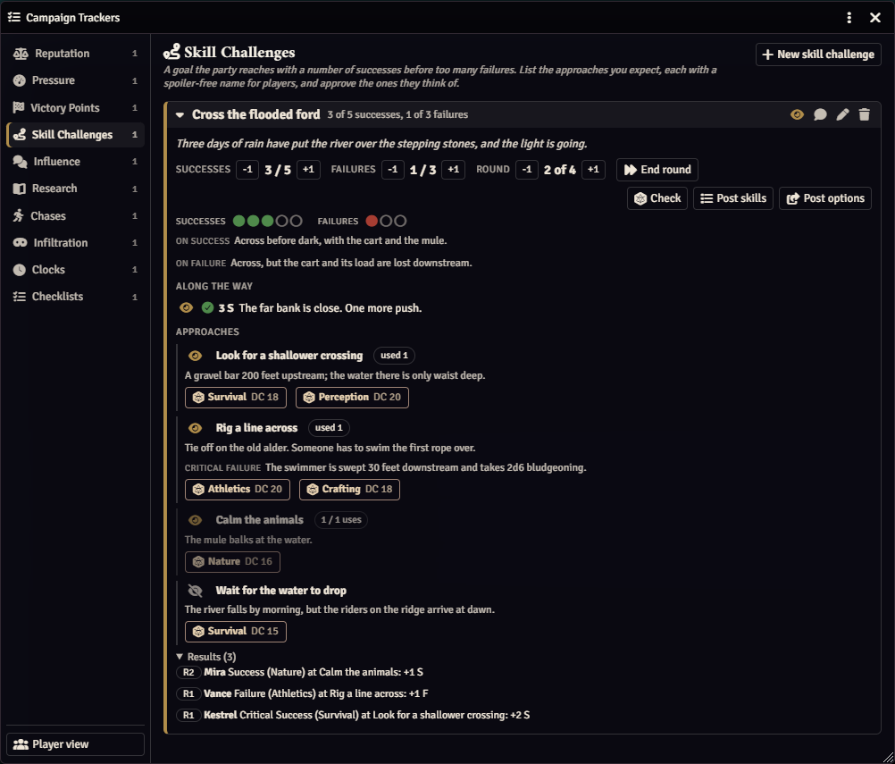</td>
<td width="50%" valign="top">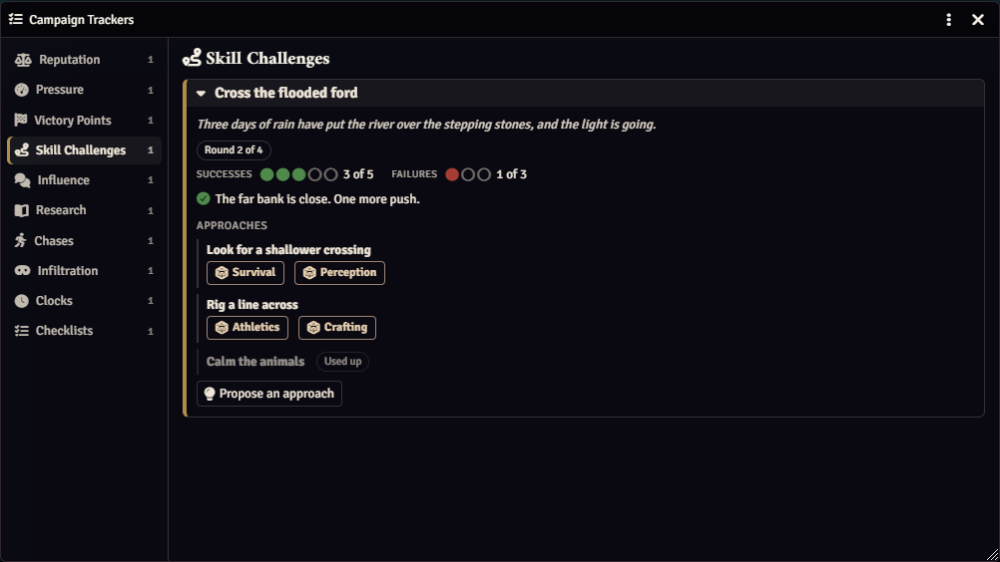</td>
</tr>
<tr>
<td valign="top"><b>Skill challenges</b>, as the GM sees it: what each approach really is, its DCs, a consequence on a critical failure, a hidden approach, and the results so far.</td>
<td valign="top">The same challenge in the players' window: spoiler-free approach names, no DCs, and a button to propose their own.</td>
</tr>
</table>
<table>
<tr>
<td width="50%" valign="top">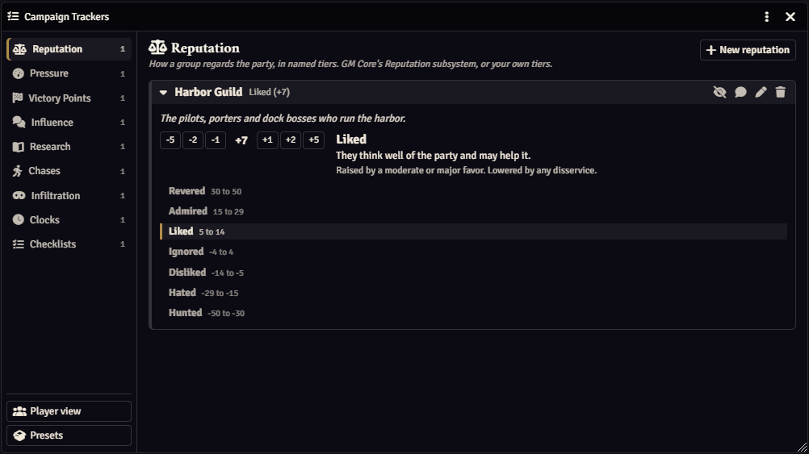</td>
<td width="50%" valign="top">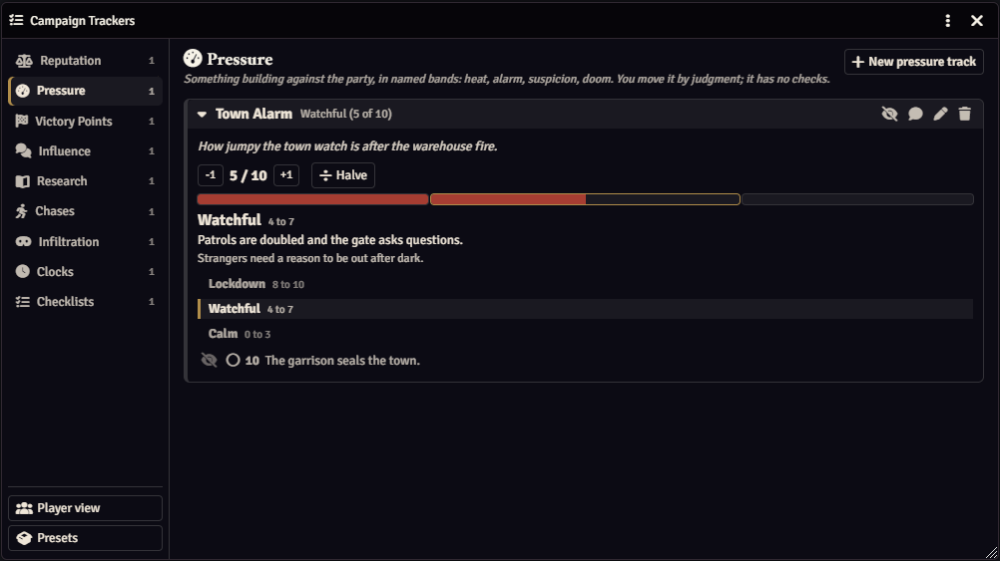</td>
</tr>
<tr>
<td valign="top"><b>Reputation.</b> How a faction regards the party, on GM Core's tiers (read from the PF2e system) or your own. Each tier can say what it means and what moves it.</td>
<td valign="top"><b>Pressure.</b> Something building against the party (heat, alarm, suspicion) in named bands that you move by judgment.</td>
</tr>
</table>
<table>
<tr>
<td width="50%" valign="top">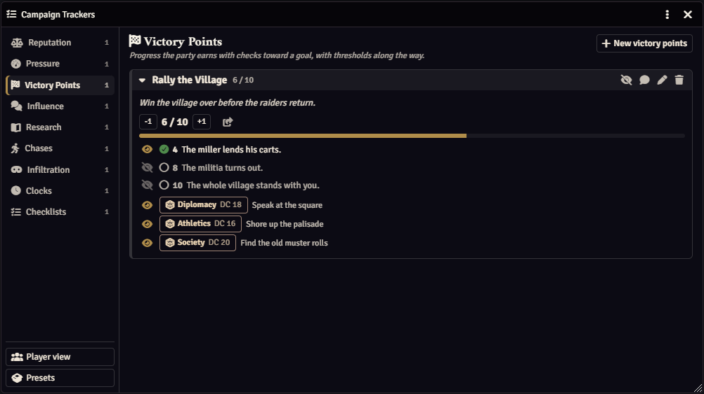</td>
<td width="50%" valign="top">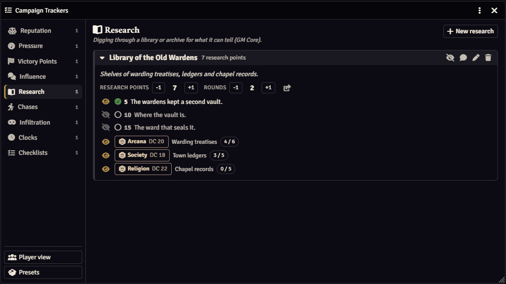</td>
</tr>
<tr>
<td valign="top"><b>Victory Points.</b> Progress toward a goal, with thresholds that unlock as the party reaches them and the checks that earn points.</td>
<td valign="top"><b>Research.</b> A library or archive, with research points per source and what each threshold turns up.</td>
</tr>
</table>
<table>
<tr>
<td width="50%" valign="top">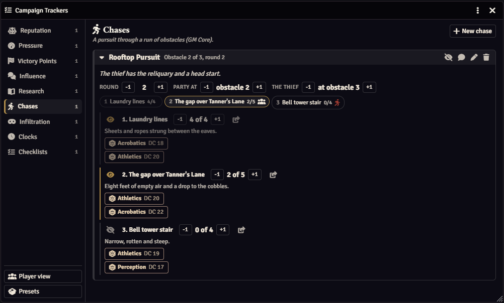</td>
<td width="50%" valign="top">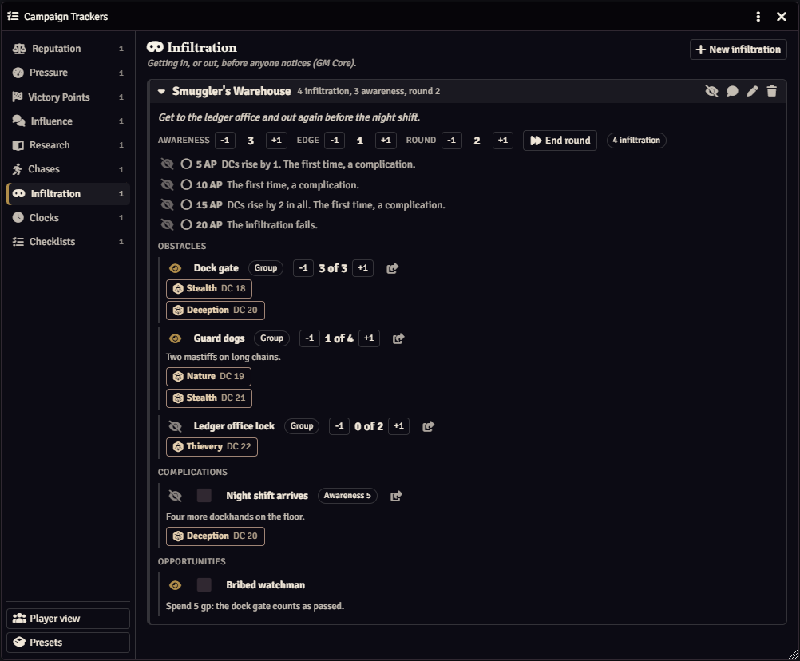</td>
</tr>
<tr>
<td valign="top"><b>Chases.</b> A run of obstacles, the party's progress through each one, and how far ahead the quarry is.</td>
<td valign="top"><b>Infiltration.</b> Awareness, edge, obstacles, complications and opportunities. The infiltration is won when the party has overcome every obstacle.</td>
</tr>
</table>
<table>
<tr>
<td width="50%" valign="top">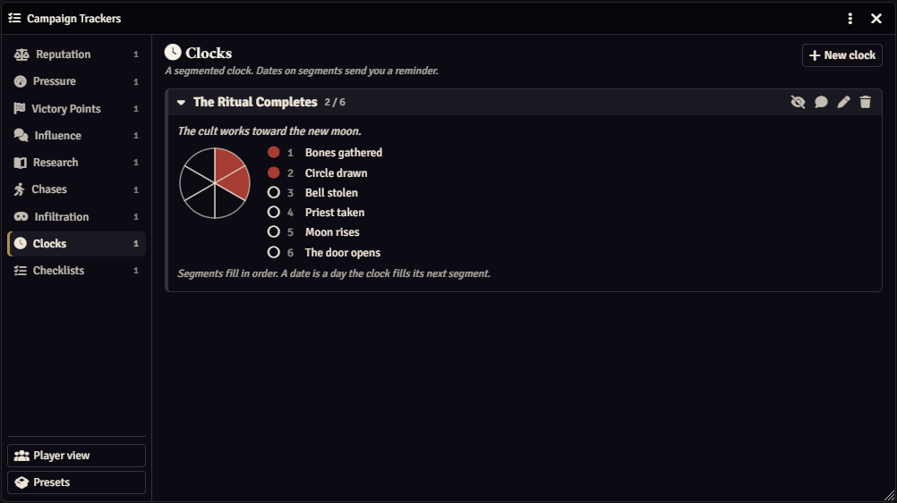</td>
<td width="50%" valign="top">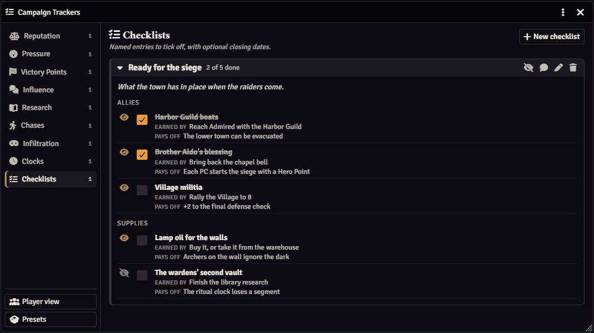</td>
</tr>
<tr>
<td valign="top"><b>Clocks.</b> A segmented clock. Give segments in-game dates and you get a whisper when the calendar reaches them.</td>
<td valign="top"><b>Checklists.</b> Things to gather or prepare, what earns each one and what it pays off, with optional closing dates.</td>
</tr>
</table>

## Hidden until revealed

Every tracker starts hidden. The eye on a tracker shows it to players; inside it, the eyes on tiers, thresholds, checks, obstacles and entries show those too. Players never see your notes or the "GM only" text, and roll cards show DCs only as PF2e's own "show DCs" setting allows. "Player view" at the bottom of the tab list shows you the window as players see it.

Your data is kept in a journal entry called "Campaign Trackers (GM data)", hidden from players. Leave it where it is: the module refuses to delete it, and warns if a copy of it turns up. Players' windows are drawn from a copy of what you have revealed, nothing more.

Hidden means hidden from the players' screens, not secret. Foundry sends every journal entry and world setting to every player's browser, whatever its permissions, so a player who goes looking in the browser console can read all of it: your notes, hidden trackers, DCs (the ones on roll cards and check cards too). Keep anything truly secret out of Foundry.

## Undo

**Undo** at the foot of the tab list takes back the last change you made in this browser, in the window or the quest panel: a tick, a counter, an edit, a deleted row or a deleted tracker, a reveal (which hides it again). Players' changes, date reminders, presets and roll cards aren't in it; a roll card has its own Undo. Ctrl+Z does the same while you work in the window (not while you type in a field). It goes back up to twenty changes, newest first, and takes back only what that change did: a number by the amount it moved, other values and rows only where nothing has changed them since. It doesn't reach across a reload or an Import data.

## Backup: export and import

The window's title-bar menu has "Export data", which downloads everything as a JSON file, and "Import data", which replaces everything with such a file after asking. Export before a session, and before you upgrade.

One tracker at a time: **Export this tracker** in a tracker's menu downloads it alone, and **Import a tracker** in the title-bar menu adds one from such a file, beside what is there, with a new id and hidden from players. Use it to reuse a skill challenge, build next session's chase from the last one, or share a quest with another GM.

If the stored data ever can't be read, nothing can be changed until it's fixed: export it (you get the text as it is), fix the file, import it. To delete the data journal on purpose (say, to remove a duplicate), export first, then run

```
game.modules.get("pf2e-campaign-trackers").api.unlockStore("<journal id>")
```

and delete it. Without an id it unlocks the journal in use.

If you have the window open in two tabs, the one that saves second reloads the other's data instead of overwriting it, and tells you.

## Posting to chat

The speech bubble posts what players would see of a tracker: a standing's tier, a clock's face, where the chase stands. Use it when you tell the table something changed. On a hidden tracker it asks first.

## Checks and the apply button

Each check has a skill, a DC and what it's for. Skill is the PF2e slug: athletics, perception, will, or a lore such as sailing-lore.

- Click a check to roll it for the selected tokens (or a player's own character).
- The share icon posts the checks to chat as buttons players click to roll. On Influence, Research and Victory Points only revealed checks are posted.
- The roll card gets an Apply button that only you see. It says what it will do ("Success, +1 at The open lead") and does nothing until you click it. After that the card says what was applied.

Points per result come from GM Core's rules as the PF2e system has them, and you can set your own per tracker (an empty field uses the rules, shown faintly). Where the rules give no plain number for a result, the roll card says so, with nothing to apply, until you set one. On PF2e 8.7.0 that's a failure on Victory Points, Influence, Research and Chases (the rules give a failure no points there by saying nothing about it): type 0 in that field to count failures as no points. Infiltration works the same way for its infiltration and awareness points. A roll made from the character sheet isn't tied to a tracker and has no Apply button; use the + and - buttons instead.

When rolls are waiting for Apply, the tracker's card in the window says how many, with **Apply all**, which applies each in the order they were rolled. Each card keeps its own Undo.

Once applied, the card says what it did and has an Undo, which takes back exactly that roll's result and nothing done since. When a player rerolls an applied check with a hero point, PF2e replaces the roll card; the new card says what the first roll applied and offers to replace it with the new result. That offer needs a GM logged in at the time of the reroll; otherwise Undo the first result yourself before applying the new one.

On an infiltration, each result earns infiltration points at an obstacle, adds awareness, or both, as the rules say. The infiltration is won when the party has overcome every obstacle: a group obstacle when its progress reaches its points, one each character faces when every party member has. An **IP goal**, if you set one, is won by the total of infiltration points instead. Awareness thresholds are yours to set for each infiltration; the rules don't give a table for them.

**Rules from the PF2e system.** The DC for each level, the DC adjustments beside a DC field (Easy, Hard), GM Core's reputation tiers and range for a new Reputation tracker, and the points each degree of success earns in Victory Points, Influence, Research, Chases and Infiltration are read from the PF2e system's GM Screen journal when a GM logs in. No copy is kept in the module. If a system update moves a table, you're told once; a DC is then left for you to type, a new Reputation tracker starts with no tiers, and points come only from the numbers you set on the tracker.

## Reminders

When the in-game date reaches or passes a date on a clock segment, a checklist entry or a quest, you get one whispered reminder listing everything due, even after a time skip. Nothing changes by itself: you fill the segment or tick the entry. On a clock set to "Fills in order", each date fills the next empty segment. Turn reminders off in the module settings.

You also get a whisper when a threshold is crossed, a tier or band changes, or the party clears an obstacle or catches the quarry.

Dates belong to the calendar they were set on. If the world's calendar changes (a calendar module turned off, say), every date would read as another day, so reminders pause and you're told. If you changed calendars on purpose, click **Use this calendar** at the foot of the tab list.

## Presets

A module can register trackers with

```
game.modules.get("pf2e-campaign-trackers").api.registerPreset({
  id, label, version, trackers: [...]
})
```

They are added hidden the first time. When the version changes, their text is updated and values, progress, ticks and reveals are kept (for a skill challenge, its counts, the uses of each approach and the list of results). Tiers, thresholds, checks, segments and entries you added yourself stay (so do ones the preset dropped; remove those by hand). "Presets" at the bottom of the tab list reloads a preset's text by hand.

For quests, an update keeps the status, ticks, counts, reveals, the Party Journal, the focus and the "Players see the due date" switch. A giver, picture, due date, loot actor, planned reveals, link, a lead's clues or where a clue is filed, set in play, stays unless the preset gives its own. Followed leads stay followed. A lead's `to` and an objective's `link.tid` can name another tracker in the same preset by its key; it's matched to that tracker's stored id.

## For macros

```
const api = game.modules.get("pf2e-campaign-trackers").api;
api.adjust("tracker-id", "value", 1);
api.set("tracker-id", "segments.2.state", "filled");
// adjust and set change any tracker for the GM. Run by a player, they reach only a party quest the player may edit,
// and only what the window lets them change, checked by the GM's client as an edit in the window is.
api.reveal("tracker-id");
api.list()   // every tracker, with its id
api.open()   // open the window where it was left
api.propose()   // propose a check outside a skill challenge (the selected token's character, or the user's own)
api.open("reputation")   // open it on a tab: "quest", "reputation", "pressure", "points", "challenge", "influence",
                         // "research", "chase", "infiltration", "clock", "checklist", a tab's label ("Victory Points"),
                         // or a tracker's id (its tab; for a quest, that quest)
api.openQuest("quest-id")   // open the window on a quest the user can see
api.quests()   // the quests the user can see (the GM: all): id, name, status, statusLabel, category,
               // done and total objectives, revealed, party, focus, and the user's mark ("new", "updated" or "")
api.questHTML("quest-id")   // the quest as players see it, read-only, as HTML (null if players can't see it)
api.markQuestSeen("quest-id")   // clear the user's New/Updated mark on it
api.revealLink("quest-id", ["part-id"], "The porch door")   // a reveal link's text (GM)
api.revealParts("quest-id", ["part-id"], { ask: false })   // reveal as a reveal link does; ask: true shows the list (GM)
api.waitingQuests()   // how many quests are New or Updated for this player
api.since(Date.now() - 7 * 86400000)   // GM: what the party learned and did since then, oldest first:
                                       // [{ at, tid, quest, what, text }] (see "Since last session" in quests.md)
// Hooks: "pf2e-campaign-trackers.changed" when trackers or marks change; "pf2e-campaign-trackers.questLink"
// (id, link) when a quest link is clicked: return false to show the quest yourself.
```

## Language

The module's text is in `lang/en.json`. A translation goes in `lang/<language>.json` beside it, with the same keys, and a line in `module.json`'s `languages`. The rules tables come from the PF2e system in its own language; the points per degree of success are read from the English wording, so in a translated system you set them yourself.

## What needs a GM logged in

Players' ticks, follows, filing, Party Journal entries and party quests go through the active GM's client. Each request gets an answer: if none comes within fifteen seconds (the GM's browser closed without a word, say), the player is told it may not have gone through. A check card ticks off each character as they roll only while a GM is logged in, and the offer to replace a hero-point reroll's result needs a GM logged in at the time of the reroll; otherwise Undo the first result yourself before applying the new one.

## Limits

DCs travel in the data of roll cards and check cards, and in the players' copy of revealed checks, so a player who looks in the browser console can read them. A player can also change their own proposal card from the console, as with any roll in Foundry; nothing here is tamper-proof. A reveal link written by a quest's name, rather than its id, shows that name in the page's source.
