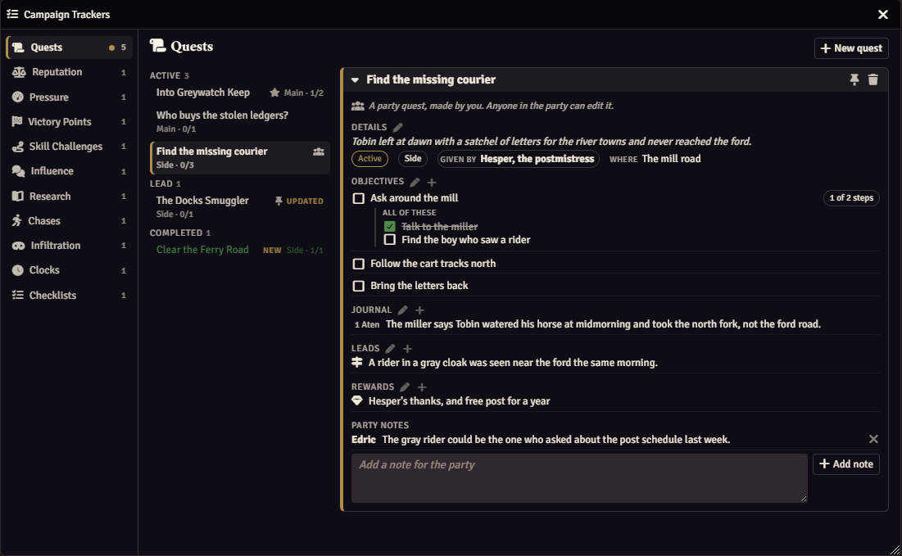
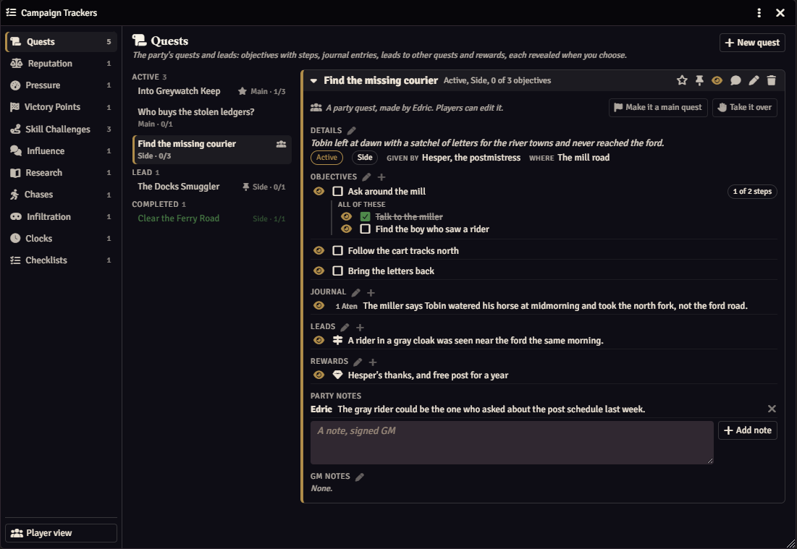
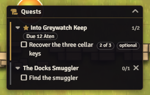
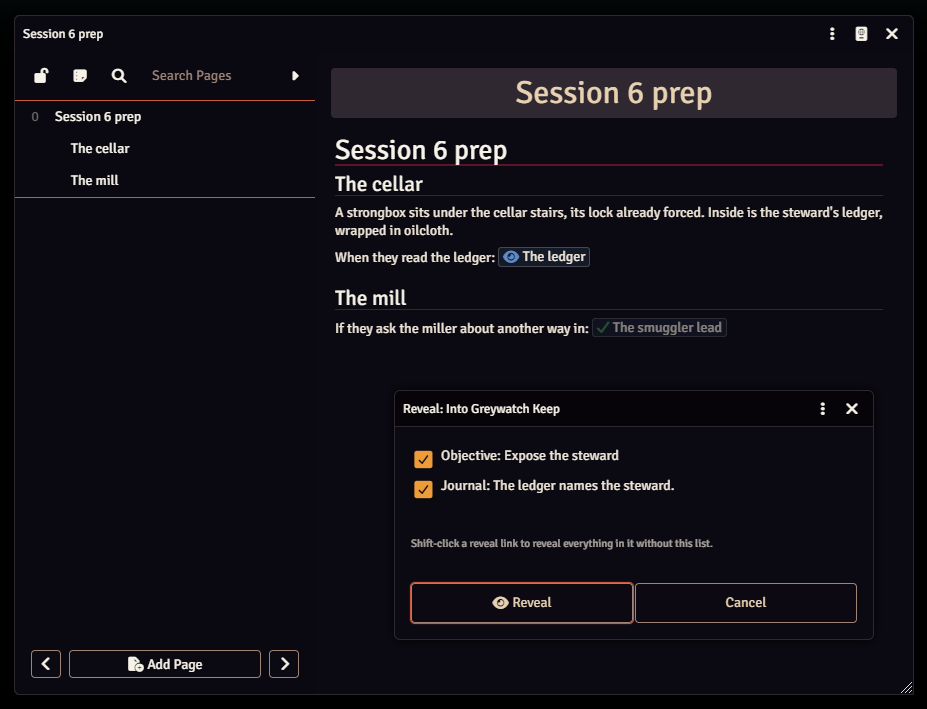

# PF2e Campaign Trackers: quests

Back to the [README](../README.md), or the [guide](guide.md) for everything else.

A quest log for the party: what they've taken on, what's next, what they've learned and what it pays. Quests sit in a list on the left, grouped by status, with the chosen quest beside it like a journal. Every part starts hidden, so you can write a quest out ahead of time and reveal it a piece at a time.

**What a quest holds.**

- A status (Lead, Active, Completed or Failed) and a category you name (Main and Side to start). Completed quests show green in the list and failed ones red.
- A picture, who gave it (drop an actor, or type a name), where, and a due date.
- **Objectives**, each with optional **steps** under it. An objective with steps is ready to mark done when all of them are, or when any one is (you choose). Objectives and steps can be optional and can have a count ("3 of 5 keys").
- **Clues**: what the party has learned, each with a date if you like, newest revealed first. A clue can be filed under the objective or step it belongs to.
- **Leads**: a line of text that can point to another quest, and reveal clues. A followed lead is struck through and put away.
- **Rewards**: text, and a loot actor if it's treasure.
- Notes only you see, on the quest and on each objective, step, lead and reward. They show in a purple box marked GM, so they never read as something players see.

A quest's header keeps three buttons in sight: the star (the party's focus), the eye and the speech bubble (post to chat). The rest are in its menu, the three dots: pin it to your panel, make a reveal link, copy a link to the quest, Edit, Duplicate, Export this tracker, and, set apart at the end, Delete. The menu's Edit (and the pencil it brings while you edit) edits all of the quest. Each section also has its own pencil and +, so you can add an objective or a GM note without opening the rest.

Each section (Objectives, Clues, Leads, Rewards, Party Journal) folds to its heading with the arrow in front of it, so a long quest stays short; each quest remembers its own folds in your browser.

**Running it.** Click an objective's box to mark it done, click again to open it; right-click (or Shift+Enter) marks it failed (struck through in red). Each objective, step, clue, lead and reward has an eye: reveal it when the players should know. The eyes of rows already revealed are dimmed, so what players can't see yet stands out; on your side, what they can't see sits in a **Hidden** fold under each list.

**Clues.** The newest revealed clue is at the top, for you and the players. To keep a long quest readable, drag a clue by the grip at the end of its row (it shows when you point at the clue) onto the objective or step it belongs to, click the grip (or press Enter on it) and pick one from the list, or pick one under "Filed under" in its editor: the Clues section shows clues not filed yet first, then a fold for each objective or step, the one with the newest clue first. A finished objective's fold starts closed, so finished threads tuck themselves away. Objectives show how many clues are filed under them. Drag a clue onto the Clues heading to unfile it. You can file a hidden clue ahead of time; it shows in Hidden with a tag naming its fold, and goes there when revealed. Each person's open and closed folds are kept in their browser.

**What happens when something is done.** In an objective or step's editor, "When it's done, offer to reveal" lists the parts you want revealed once it's done: the next objective, a clue, a lead. When it's marked done, you get a whispered card with those parts ticked; untick any, then Reveal. The card also offers to mark the objective done once its steps add up. Nothing is revealed until you click.

**Leads.** A lead can point to another quest, and can reveal any of the quest's clues ("Reveals clues" in its editor). When you reveal a lead whose quest or clues players can't see yet, you're offered them, ticked; the completion card and reveal links offer them the same way. The box in front of a lead marks it followed: it's struck through and moves into a closed **Followed** fold at the end of the leads, and if its quest or clues are still hidden you're offered them. A quest shows which leads point to it, so you can follow a thread back.

**Linking to other trackers.** With "Watch" in its editor, an objective or step can watch another tracker: a clock filling, a skill challenge won or lost, victory points, research, influence, reputation or pressure reaching a number, a checklist entry ticked, a chase won, an infiltration's objective reached (every obstacle overcome, or its IP goal). It shows how that tracker stands ("Rally the Village: 6 of 8"), and when it gets there you get a card offering to mark it done. It never ticks itself.

**Treasure.** Revealing a reward linked to a loot actor offers to let players open that actor (Observer). It's never done for you.

**Deadlines.** A quest's due date shows on the quest, and you get a reminder when the calendar reaches it (see [Reminders](guide.md#reminders)). Players see the due date unless you turn off "Players see the due date" for a secret deadline; the reminder comes either way.

**What players can do.**

- Read what you've revealed, and nothing else: no GM notes, no hidden objectives, steps or leads. A lead names the quest it points to only once that quest is revealed.
- Tick a revealed objective or step done. You get a card each time, with anything you prepared to reveal. They can untick what a player ticked, but not what you marked.
- Mark a revealed lead followed. You get a card offering whatever it points to that they can't see yet. They can undo a player's mark, not yours.
- File revealed clues under the objectives and steps they can see, by dragging or from the grip's list. A clue you filed under something they can't see stays where you put it.
- Turn ticking, following and filing off with the setting "Players can tick objectives, follow leads and file clues". On a party quest the party can always do them, and you get no card.
- Write in a quest's **Party Journal**, signed with their character's name. Everyone sees it. Players delete their own entries; you can delete any. The magnifying glass on an entry makes it a clue, dated today, revealed and signed with the player's name, so a good find becomes part of the record. A gold one means it's already a clue.
- Start party quests of their own (below).
- Players' ticks, follows, filing, Party Journal entries and party quests go through a GM's client, so a GM needs to be logged in for them.

**Party quests.** Players can start a quest themselves with **New quest** on the Quests tab, for anything they want to keep track of, so you aren't the only one making and keeping quests. Anyone in the party can edit a party quest: its name, summary, status, category, giver, place and due date, its objectives and steps, clues, leads and rewards. What they add is revealed. Only the player who made it, or you, can delete it. The rest of the party gets a notice when one is made; edits only mark it Updated. Party quests have a party icon in the list.

A party quest is yours to edit too, and you can add hidden parts and GM notes that players can't see or change. Two buttons sit on it: **Make it a main quest** sets its category to Main and leaves it a party quest; **Take it over** makes it an ordinary quest of yours, with everything in it kept. Players still see it, go back to ticking and writing in the Party Journal, and are told you took it over. Turn party quests off with the setting "Players can make quests".

<table>
<tr>
<td width="50%" valign="top"></td>
<td width="50%" valign="top"></td>
</tr>
<tr>
<td valign="top">A party quest in the window of the player who made it: every section has its pencil and +, and they can delete it.</td>
<td valign="top">The same quest as the GM sees it, with <b>Make it a main quest</b> and <b>Take it over</b>.</td>
</tr>
</table>

**Notices.** When a quest is revealed, changes, is completed or fails, or gets a note, players get a short notice on screen, and the quest is marked New or Updated in their list until they open it. Nothing goes to chat. A player who logs in to quests that changed while they were away gets one notice saying how many, and the quest panel's header shows the count until they look. The setting "Quest notice sound" plays a sound with the notice (off unless you pick one).

**The quest panel.** A small panel on screen with the quests in play and their open objectives, so nobody has to open the window. It shows the party's focus first: the star on a quest makes it the focus for everyone. Then the quests each person pinned with the pin (up to three in all; pins are kept in that person's browser). Players can tick objectives right in the panel, and clicking a quest's name opens it in the window. Your panel also shows hidden objectives, dimmed. Drag the panel by its header, or press the arrow keys on its Move button (with Shift, farther); it remembers where. Shift+Enter on a box marks the objective failed, for the GM. Each person can close it with the × on its header (or the setting "Show the quest panel"); **Show the quest panel** on the Quests tab brings it back. Turning off "Players can open the trackers" hides it from players too.

**Quest links.** Write `@Quest[id]` in any journal page (or `@Quest[id]{a label}` for other words), and it shows as a link that opens the quest. Drag a quest from the Quests list into a page's editor to make one; a quest's id is also in `api.quests()`. A player sees a link to a quest they can't open yet as a faded link.

**Reveal links.** A button for your prep notes that reveals parts of a quest when the moment comes, so you don't have to find the right eyes at the table. In your view of a quest, each objective, step, clue, lead and reward shows a link icon when you point at it: drag it into a journal page, or click it to copy the link. For one button that reveals several parts, click the link icon in the quest's header, tick the parts, and drag **Drag or copy** into the page (with nothing ticked, the button reveals the quest itself). In the page it reads like `@QuestReveal[quest-id|part-id,part-id]{The porch door}`; the words in braces are the button's label. To add parts to a link later, open the page to read it (not to edit it) and drop the parts' link icons (or a picked set) on its button; the link in the page's text gets them, and keeps its label.

Clicking the button lists what it will reveal, all ticked: the quest if players can't see it yet, each hidden part, the objective a step sits under, the quest and clues a lead reveals, and loot players can't open yet. Untick anything to keep it hidden, then **Reveal**. A step always brings the objective it sits under, as it does with the eye, since players see nothing of a step under a hidden objective. Shift-click reveals everything on that list at once, as Shift skips the dialog when you roll. Either way it's one change, so players get one notice. Pointing at the button lists what it covers, with a tick on what players already see; it fades with a check once they see it all, and shows a dashed red border when something it names was deleted. Players see only the label, as plain text, with no hint of what's behind it; a link made by dragging is labeled with the part's text (or the quest's name), so change the label in a page players can read. A reveal link in chat, or in a page a player changed last, always shows the list, even with Shift.

**In Bayard's Campaign Journal.** With [Bayard's Campaign Journal](https://github.com/Sir-Bayard/bayards-campaign-journal) installed, its Quests tab lists the quests and shows each one as the players see it, and quest links clicked there open the quest on that tab.

**Since last session.** **Since last session** on the Quests tab lists what the party learned and did since a time, quest by quest: quests and their parts revealed, objectives and steps done or failed, leads followed, status changes. It starts at your last session (the last time you logged in at least four hours before), and you can pick another time. `api.since(time)` gives the same list to a macro or another module.
