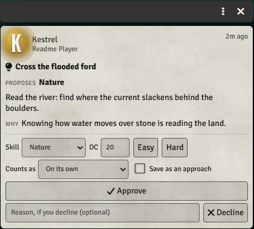

# PF2e Campaign Trackers: skill challenges

Back to the [README](../README.md), or the [guide](guide.md) for everything else.

A skill challenge is a goal the party reaches with a number of successes before too many failures: crossing a flooded river, talking a mob down, finding the way through a marsh. It's built for the players to say what their characters do and why a skill fits, not just to pick from a list.

**Setting one up.** Under Edit:

- Successes needed, failures allowed and, if you like, a number of rounds. Each result adds successes and failures; by default a critical success adds 2 successes, a success 1, a failure and a critical failure 1 failure each. Change any of them.
- What happens on success and on failure (GM only), and milestones along the way at a number of successes.
- **Approaches**: the ways through you expect. Each has a name players see, which you keep free of spoilers ("Look for another way across"), the real story for you ("A gravel bar 200 feet upstream makes a shallower crossing"), an optional consequence on a critical failure, an optional limit on uses, and one or more skills, each with a DC. Reveal an approach with its eye when the players should know about it.
- **Players see the counts**: off, and players see the approaches but not how close they are.
- **Proposals need what and why**: on by default. Turn it off when pace matters, and players can propose with just a skill.
- **One check per PC per round**: Apply tells you when a character rolls a second time in a round. It warns; it doesn't stop the roll. The card shows the party's names with a tick for each who has rolled this round.

**Running it.** The challenge card has four buttons:

- **Post skills** posts the skills that could help, from every approach, hidden ones included, with no approaches and no DCs. Players say what they do.
- **Post options** posts the revealed approaches by their players' names, each with its skills as roll buttons.
- **Check** calls for a check on the fly. Pick the characters, the skill and the DC, and what it counts as: one of your approaches (it counts a use) or on its own. Then send them a roll button each, or roll for them at once. Tick **Apply these as they are rolled** and each character's first roll goes onto the challenge as it's rolled, at that DC, with no Apply click; each roll card keeps its Undo. A second roll, someone you didn't call, or another DC waits for your Apply as usual.
- Rounds and End round show when the challenge has a round limit or one check per round.

**Proposals.** Both chat cards, and the challenge in the players' window, have **Propose an approach**. A player picks one of their character's skills and writes what they do and why the skill fits. The proposal goes to chat for the table to see. On it you can change the skill, set the DC (Easy and Hard move it by the PF2e system's DC adjustments), choose what it counts as, save it as a new approach for the challenge (players see it by what they wrote), and approve or decline it with a reason. Approved, it becomes a roll button for that player.



The DC on a proposal or a check starts from an approach that uses the same skill, or else from the DC for the character's level. The DC by level and the Easy and Hard steps beside it are read from the PF2e system; if a table can't be read, you're told once and type the DC yourself.

**What players see.** Never a DC: not in their window, not on the cards, not on their roll, which says only "Success" or "Failure". Every roll records through your Apply button as usual, and the challenge keeps a list of the results. A critical failure on an approach with a consequence shows it to you on the Apply box. As with everything here, DCs aren't secret from a player who digs through the browser console (see [Hidden until revealed](guide.md#hidden-until-revealed)).

The DC filled in on a proposal or a check comes from a revealed approach that uses the same skill and isn't used up. Hidden approaches are never picked for you: choose one under "Counts as" when that's what the player has stumbled on.

## Proposals outside a challenge

The same proposal works in ordinary play, when a player wants to try their Engineering Lore on something and there's no challenge running. Make a Script macro with this line, give players Limited permission on it, and put it on their hotbars (Bayard's Hotbar Expansion's editor can put it on everyone's):

```
game.modules.get("pf2e-campaign-trackers").api.propose();
```

It proposes for the player's selected token, or their own character. The card works as in a challenge, without "Counts as": the DC starts from the character's level, players never see it, and the roll records nothing in any tracker.
